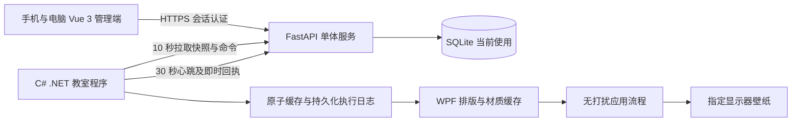
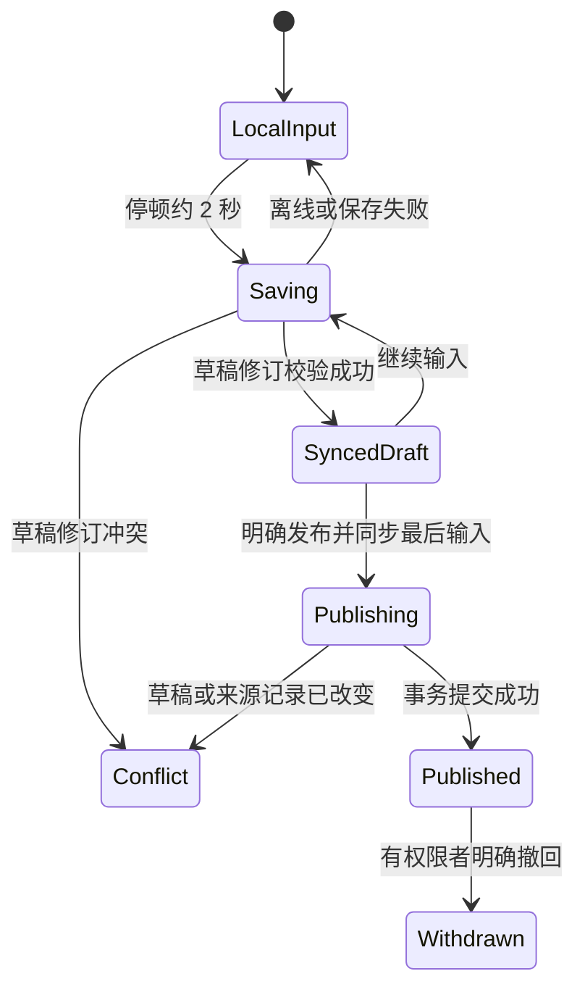

# 班级看板首版系统与交互设计

依据《教室桌面看板产品设计文档_v1.3》，2026 年 11 月 2 日。

本设计把教师管理、正式信息和教室展示分为三条独立链路。教师可以随时写作业，只有明确发布才改变正式信息；设备可以继续接收更新，只有成功应用画面才报告展示成功。首要工程门槛是课堂无打扰，必须先完成 Windows 实机验证，再推进试点。

本轮按确认后的范围推进 Vue 管理端、FastAPI 后端和 C# Windows 客户端。账号、草稿、发布、绑定与控制均通过真实接口实现；首次使用为空状态。Windows 默认不启用壁纸写入，只有本机明确启用后才应用。以下章节是实施规格；实际完成与验证范围见 README 和验收记录，不能把界面运行或自动化测试通过视为全部 P0 已验收。

## 1 设计判断

1. 教师的主要任务是快速发布。班级首页提供发布作业、发布提醒、继续草稿、控制大屏四个直接入口；设置操作移到次要层级。
2. 私人草稿必须成为独立对象。编辑正式内容也先生成本人草稿，不用一个 `is_draft` 字段切换正式记录。
3. 展示版本、控制修订和现场操作世代分别计数，不能混成一个版本号。草稿同步不产生展示版本。
4. 班级拥有内容，设备只是一个可撤销的展示终端。换电脑无需迁移作业或成员。
5. 颜色表达科目和状态，同时保留文字。玻璃效果用于边缘与背景，正文使用不透明底板。
6. 设计允许空白。首次进入不填充演示作业；预览和示例数据必须明确标识。
7. 图片壁纸是需要验证的产品方案。每分钟重绘、分页、系统壁纸策略、系统主题与多显示器都可能影响安静应用，不能仅以“不激活窗口”证明可用。

## 2 系统结构



教师管理端与教室程序不直接通信，也不依赖同一局域网。首版无需 WebSocket、Redis、任务微服务或图片生成服务器。服务端不为每次设备请求生成图片；排版和壁纸合成在教室设备执行。

本轮按确认后的范围先用 SQLite。ORM 与 Alembic 保持数据库独立，SQLite 写事务串行化，后续可通过停服迁移工具复制到空 PostgreSQL 库并逐表核对；迁移后统一更换同步世代。数据库选择不改变权限、修订、草稿隔离或回执语义。

生产代码建议拆为 `frontend/`、`backend/`、`desktop/`、`contracts/`。先以单体后端部署，以数据库事务承载权限、发布和控制受理的一致性。数据库迁移使用 Alembic，配置通过环境变量注入。

### 后端边界

| 模块 | 负责内容 | 一致性边界 |
| --- | --- | --- |
| auth | 注册、口令、可撤销会话、登录限速 | 每次请求校验有效会话和同步世代 |
| classrooms | 班级、成员学科、邀请审批、所有权、归档 | 同一事务重验成员与班级状态 |
| publishing | 私人草稿、正式内容、修订、多班批次、待办完成 | 全部目标一次提交或全部拒绝 |
| schedules | 作息、周模板、日期例外、学期范围 | 禁止节次重叠及模板区间冲突 |
| displays | 完整布局、主题、倒计时、寄语 | 布局整体修订，不逐模块发布 |
| devices | 配对、凭证、快照、心跳、应用回执 | 绑定、同步世代、报告序号隔离 |
| controls | 命令受理、分组替代、到期、回执历史 | 控制修订与实际设备状态分开 |
| operations | 配置导出、审计、备份与还原 | 导出不含口令或凭证；还原更换世代 |

## 3 页面与导航

电脑使用侧栏和宽编辑区；手机使用班级、记录、我的三个底部入口。班级首页下钻进入编辑、设备控制和设置，返回后保留班级与查看日期。路由携带 `classId`，切班后重新计算权限，禁止沿用上一班的编辑目标。

| 页面 | 主要信息 | 主要操作 |
| --- | --- | --- |
| 我的班级 | 班名、本人角色、设备联系摘要 | 创建、加入、进入 |
| 班级概览 | 日期、当天作业、提醒、设备摘要、本人草稿 | 发布作业、发布提醒、继续草稿、控制大屏 |
| 发布编辑 | 明确的目标班级、科目、纯文本、展示起止、截止时间 | 保存本人草稿、预览、明确发布 |
| 正式记录 | 班级、学科、日期、展示状态、作者、修订 | 详情、创建修改草稿、撤回、复制 |
| 私人草稿 | 目标班级、科目、来源、最近保存、同步状态 | 继续、主动放弃 |
| 大屏控制 | 单台设备、连接与暂停来源、缓存与应用、分页、操作结果 | 请求同步、暂停、恢复、临时指定页 |
| 展示设计 | 双主题、材质、字号、图标留白、模块、目标尺寸预览 | 调整、恢复默认预览、明确发布布局 |
| 班级设置 | 学科、课表、成员、设备、倒计时、寄语 | 按权限维护、导出、归档 |

普通科任教师能够发布获授权学科内容、维护本人正式内容及本人草稿，并只读查看布局和设备状态。管理员代改他人正式内容先填写 1 至 100 字原因；原作者保持不变。所有者专属的任命管理员、转移和归档不能仅依靠前端隐藏。

### 发布编辑

使用一个编辑表单完成作业与提醒；提醒支持公共或学科范围。主按钮始终说明动作及目标数量，例如“发布到 2 个班”。副文案说明“发布后才更新班级看板”。提交截止与展示结束分别设置。

展示开始默认立即，未来最多 30 天；默认结束跟随开始所在日期的次日 08:00，提醒为次日 18:00。手工修改结束后不再覆盖。周五提供明确的周末选项，其他日期也可自定义。查看日期切换不会改变设备日期。

点击发布时锁定表单，等待当前保存结束，再保存全部最终输入，得到最新 `draft_revision`，随后发送发布请求。任何保存失败或冲突都中止发布并保留输入。超时沿用原幂等键查询结果，不把未知结果当作失败重新发布。

### 冲突处理

草稿修订和正式内容修订独立验证。冲突页并列显示“本次未提交内容”和“最新版本”，保留本地输入。用户以最新版本为基础重新编辑后才允许新提交，不提供无说明的最后写入覆盖。权限失效仍保留本人草稿，禁用失效目标。

## 4 状态设计

### 内容与草稿



“待展示、展示中、展示结束”是时间计算结果；不是发布生命周期。待办另有完成状态，逾期不等于完成。撤回保留历史，重新使用时复制为新记录。

### 设备信息

| 维度 | 显示规则 |
| --- | --- |
| 连接 | 最近认证联系超过 90 秒为离线，展示具体时间 |
| 展示 | 运行、远程暂停、本机暂停、保护延后、应用异常分别表达 |
| 缓存 | 当前绑定与世代中的 `cached_version` |
| 应用 | 最近成功设置画面的 `applied_version`、时间、实际主题材质 |
| 命令 | 已受理、等待执行、保护延后、已执行、拒绝、过期、被替代、结果待确认 |

控制台不把“在线”等同于“看板可见”，不把缓存成功等同于画面应用，也不推断学生已读。预览固定标注“预览”，设备页码标注最近上报时间。

### 控制执行

命令分为同步、暂停、分页三组；只在同组内替代尚未执行的命令。受理时 CAS 校验并递增 `control_revision`；`202` 只表示受理。`sync`、`set_page`、`auto_page` 有效期 60 秒，`pause`、`resume` 为 120 秒，按开始执行时间判断。

本机暂停与远程暂停分别存储。任一有效则不展示；远程恢复只清除远程暂停。本机操作递增 `local_control_epoch`，本机恢复清除两种暂停并取消旧世代控制。暂停期间同步继续，分页禁用且服务端拒绝。设备已退出或关机时不能受理即时控制。

临时翻页携带明确的 `page_set_id` 与 `page_index`，不使用累计的 next 命令。成功后保持 120 秒；集合变化立即退出手动，旧集合命令拒绝。设备持久化命令结果，重投只返回原结果。迟到回执可以修正该条历史，不能回滚较新的现场状态。

## 5 数据与事务设计

所有时间存 UTC，业务计算显式使用 Asia/Shanghai，展示区间为 `[display_from, display_until)`。没有自动节假日推断，日期例外优先于周模板。

核心实体沿用 PRD 第 10 章。数据库约束包括有效成员唯一、有效邀请原子消费、每班一个所有者、每班最多一个转移请求、内容修订唯一、有效绑定隔离、幂等键与请求摘要匹配。所有者转移锁定班级行后重验双方与请求；接受、取消、过期互斥。跨记录约束以事务和唯一索引配合实现。

草稿保存执行 `UPDATE ... WHERE owner_id = actor AND draft_revision = expected`；正式修改同样以 `revision` CAS。生产发布事务必须：

1. 读取并锁定批次幂等记录；已成功且摘要一致则返回原结果，不一致则拒绝。
2. 校验本人开放草稿、最终修订、来源内容修订、目标数量与全部班级学科权限。
3. 一次写入各班独立 Content、ContentRevision、PublishBatch，按班递增 `class_version`，关闭草稿。
4. 提交后设备自行拉取。设备失败不回滚正式内容。

锁班级时按 ID 固定顺序，避免多班事务反向锁定。权限管理与发布按相同成员和班级锁约定序列化，避免校验与落库之间被撤权。记录独立存在，禁止以“班级 + 日期 + 科目”作为覆盖键。

归档事务撤销全部设备凭证、邀请与未完成转移。恢复不复活旧凭证。备份还原时在开放服务前生成新 `sync_epoch`，旧会话、设备及控制全部失效。

### 接口错误契约

所有写接口明确 `expected_revision` 和幂等要求。冲突返回 `409` 及最新可见修订；权限失效返回 `403` 并指出有权获知的目标；校验错误定位字段。错误体统一为：

```json
{
  "code": "draft_revision_conflict",
  "message": "草稿已在另一台设备修改，请比较后继续。",
  "request_id": "opaque-diagnostic-id",
  "details": { "current_revision": 8 }
}
```

控制提交包含幂等键、`expected_control_revision`、命令类型及参数。回执包含绑定、同步世代、现场世代、递增 `state_report_seq`、开始与结束时间。管理端查询必须返回数据上报时间，不伪造实时状态。

## 6 大屏与视觉设计

1920 × 1080 为基准，12 列网格；默认左侧 12% 留给桌面图标。页头为班名、日期时间与主事件倒计时；主区作业占约 60%，右侧提醒和课表；页脚为寄语、页码、内容同步时间、画面生成时间。课表与页头在翻页时固定。

| 令牌 | 云母浅灰 | 云母墨绿 |
| --- | --- | --- |
| 背景基色 | `#E9EEF2` | `#102A29` |
| 正文底板 | `#F8FAFC` | `#183B35` |
| 正文 | `#152C2A` | `#F1F7F4` |
| 辅助文字 | `#435954` | `#C1D2CB` |
| 强调 | `#2B6654` | `#92C6AF` |

正文默认 36px，最低 32px；模块标题 40px，班级标题 48px，辅助信息最低 22px。圆角 24 至 32px，边缘 1 至 2px，正文底板保持不透明。材质与装饰不穿过文字，不制造学生可点击的错觉。管理界面采用同色系，操作文字使用正常手机与电脑字号，不照搬大屏字号。

分页按实际排版行高和段落边界计算，单条长文拆为带科目与条目标识的续页，不能省略尾部。作业与待办参与整板分页；默认自动每 20 秒，可选 15 或 30 秒。原型验证分页流程，生产 C# 排版仍需对所有目标尺寸、中文标点、空行和长词测量校验。

布局调整保存在编辑缓冲区，预览不写正式 Layout。发布提交完整布局及旧修订，出现冲突保留当前方案。恢复默认也只进入预览。发布主题影响班级所有绑定设备，确认时显示目标班级与设备数。

设备实际样式与班级目标样式分开。系统高对比、关闭透明及本机减少效果优先，远程不能取消。本机回退不修改班级 Layout；材质失败先尝试同布局纯色，只有应用成功才报告新版本及降级原因。

## 7 Windows 可行性与实施门槛

M0 先制作单显示器实验程序，保存原壁纸状态、生成测试画面并经 `IDesktopWallpaper` 应用指定屏幕；不在原型阶段改动用户桌面。WPF 用于排版与配置。材质层按主题、模式、布局、尺寸缓存，正文与分钟时钟变化复用底图，不轮询重生成。

对 PPT 放映、白板、视频、文字输入、显示桌面、锁屏恢复、Explorer 重启、DPI 和分辨率变化逐项测试。记录前台 HWND、输入位置、全屏、音量、鼠标和闪烁观察；不能仅凭窗口句柄未变判定无中断。若无法证明当前应用操作安静，缓存最新完整版本并报告 deferred；安全时机到来再应用。

缓存使用临时文件校验后原子替换。渲染失败、材质降级、壁纸设置失败分别记录，不推进错误的应用版本。304 仍须重试已缓存未应用版本。重启、唤醒、跨日、联网触发重算；连续离线 72 小时降级。正常退出恢复原壁纸，异常退出保留可诊断的生成和同步时间；恢复程序立即重算。

试点必须完成至少一台真实教室电脑连续 8 小时及重启检查。性能目标与后排可读性来自 PRD 第 12 章，原型或单元测试通过都不替代实机验收。

## 8 开发顺序与验收对应

| 阶段 | 首要产出 | 关键验收 |
| --- | --- | --- |
| M0 | 壁纸合成、恢复、多屏边界、无打扰实测记录 | AC21、22、25、41、57、59、60 的桌面基础 |
| M1 | 账号、多班、成员学科、邀请审批、绑定、撤销 | AC01、02、05、18、19、27、29 |
| M2 | 草稿、发布事务、历史、日期、待办、课表 | AC03 至 17、24、30、31、37 至 43 |
| M3 | 控制队列、现场优先、主题布局、缓存分页 | AC20、32、35、44 至 60 |
| M4 | 配置导出、备份还原、人工升级、运维文档 | AC23、26、28、33、34、36 及全量回归 |
| M5 | 3 至 5 班试点，连续 10 个教学日 | 任务耗时、失败原因、每周人工维护次数 |

每条 AC 建立环境、步骤、实际结果和证据记录，全部适用 P0 用例通过后才进入试点。当前软件测试和安全模式联调不记为真实教室的桌面应用验收。

## 9 需在实机摸底时收敛的决定

设备 Windows 具体版本、运行时分发方式、持久化目录与还原保护、实际分辨率和 DPI、前台保护策略、学校网络与域名可达性、真实学段和学科。全部沿用 PRD 默认边界推进，不提前加入支付、家长端、成绩考勤或实时共同光标。

技术参考：[Vue 官方快速开始](https://vuejs.org/guide/quick-start.html)、[Vite 官方指南](https://vite.dev/guide/)、[IDesktopWallpaper](https://learn.microsoft.com/en-us/windows/win32/api/shobjidl_core/nf-shobjidl_core-idesktopwallpaper-setwallpaper)。桌面 API 与依赖的具体版本在实施各阶段验证并锁定。
