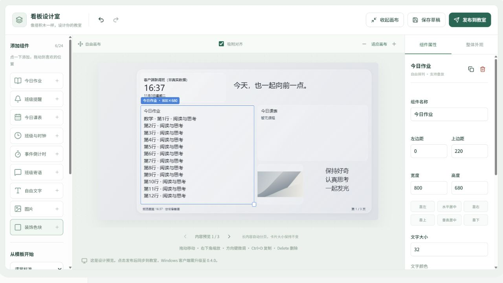

# ClassGlow 使用说明

当前是“手机 / 电脑 Web 管理端 + Windows 教室客户端 + Linux 服务端”。Android 手机和 iPhone 都通过浏览器操作同一个网页，没有独立 Android APK、iOS App 或小程序。部署后管理地址为 `https://teacher.dgplus.vip/`。

## 从安装到第一次展示

1. 部署人员在服务器运行 `sudo classglow`，选择“初始化管理员”，设置管理员账号和密码。服务器操作只出现在运维菜单中。
2. 管理员登录网站，进入“账号管理 → 添加账号”，设置老师姓名、登录账号、初始密码、身份、有效期及任教班级和学科。
3. 老师打开网站，输入管理员给的账号和密码，直接进入自己的工作台。没有注册或首次激活步骤，忘记密码联系管理员重置。

4. 班主任可创建、管理自己负责的班级，维护课表、提醒、寄语和任教学科；普通老师只维护自己被授权的学科内容。
5. 在教室电脑安装 [Windows 0.4.1 客户端](https://teacher.dgplus.vip/downloads/ClassGlow-0.4.1-win-x64-setup.exe)，从开始菜单打开。第一步阅读隐私说明，第二步生成 6 位绑定码。服务地址默认已填好，通常无需修改。
6. 班主任进入“大屏控制”输入绑定码、核对教室并确认。设备绑定码只用于绑定电脑，与高级功能激活码无关。绑定和自动同步免费。
7. 绑定成功后点“下一步”，选择是否在桌面展示、展示在哪块屏幕及是否自动启动，再点“完成设置”。两项默认关闭，勾选时尚不生效。
8. 需要高级功能时，向管理员领取绑定本人账号的许可码，在“我的账号 → 开通高级功能”填写。手机入口为“我的 → 账号与高级功能”。

基础免费：作业、提醒、课表、默认看板和基础同步。高级许可：自定义背景 / 布局、多班批量发布、远程大屏控制。身份仍决定可操作的范围，普通老师兑换许可不会变成班主任。期限区别与续期规则见 [账号与许可说明](ACCOUNT-LICENSES.md)。

## Windows 首次打开

0.4.1 将首次配置拆成三页，服务器地址收在“其他服务器”中。新绑定尚未完成展示设置时，重开程序会继续第三步。已完成配置的用户直接看到班级与运行状态，展开“查看同步详情”才显示版本和分页信息；点“展示设置”可修改本机选项。

截图来自 Windows 11 上实际运行的客户端外观预览，示例班级不连接生产服务器，也不写入壁纸或启动项。

窗口使用 [WPF UI](https://github.com/lepoco/wpfui) 的 Fluent 标题栏与云母材质，第三方许可随安装包提供。此窗口材质与桌面看板合成壁纸是不同的显示方式。

## 老师每天怎样操作

| 需求 | 操作 |
| --- | --- |
| 发作业 | 选班级 → 发布作业 → 选学科、填写正文与时间 → 发布；在许可期内且对各班有学科权限时，可一次发布到多个班 |
| 临时通知 | 班主任发布提醒 → 设置时间与优先级 → 发布 |
| 中途没写完 | 保存私人草稿，之后继续；自动保存只保存草稿，不会自动公开 |
| 修改或撤回 | 从作业与提醒记录进入编辑、撤回；代改他人正式内容需要权限与原因 |
| 调课 | 班主任进入班级设置 → 每周课表或指定日期调整 → 明确发布 |
| 自由设计大屏 | 展示设计 → 展开画布 → 添加组件 → 拖动、缩放、编辑样式 → 发布到教室 |
| 检查教室设备 | 大屏控制 → 查看在线状态、已缓存版本、已应用版本，以及命令执行结果 |
| 手机进入更多设置 | 底部“我的” → 私人草稿、班级设置、大屏控制；普通老师只显示自己有权限的入口，系统管理员还会看到系统管理 |

手机浏览器可把网站添加到主屏幕作为快捷入口。当前没有完整应用离线启动能力；已打开页面的未同步输入可以暂存在本机，恢复网络后仅同步草稿，发布仍由老师确认。

## 实际呈现效果

管理端以浅色卡片、墨绿色按钮和清晰的内容分区呈现。电脑左侧提供完整导航；手机使用底部“班级 / 记录 / 我的”，主操作集中在班级页。教室看板支持浅灰和深灰云母、三档字号、自定义背景及长内容翻页。

### 用自由画布设计 Windows 看板

具有有效高级许可的班主任或系统管理员进入“展示设计”，点击“展开画布”获得独立设计空间。左边是组件与图层，中间是画布，右边是选中组件的属性。外层大卡片保留统一材质，内部布局由老师决定。

1. 从“课堂标准”“三栏平分”“灵感便签”开始，也可选空白画布。应用模板后可以撤销。
2. 点选组件添加到画布：作业、提醒、课表、班级与时钟、倒计时、寄语，以及自由文字、图片、装饰色块。数据组件随班级正式内容更新；自由文字可以直接编辑。
3. 拖动组件移动，拉右下角缩放，也可在属性面板输入位置和尺寸。组件可以叠放、复制、隐藏、锁定、调整图层顺序和文字样式。图层列表可以选中被其他组件遮住的内容。
4. 使用撤销/重做调整设计。方向键微调，Shift + 方向键移动更大步幅，Ctrl+D 复制，Delete 删除。默认启用吸附对齐；拖动时按 Alt 暂时取消吸附。
5. 每个组件有尺寸下限，最多添加 24 个；内容增加时分页显示，组件不会被长文字撑高。预览可切换内容页。手机也能选择组件和输入尺寸，精细排版建议使用电脑。
6. 在“整体外观”上传背景图片或选纯色，调整大卡片通透度和桌面图标留白。背景居中裁切为 16:9；图片组件保留原始宽高比。上传支持 8 MB 内的 JPG / PNG / WebP，保存时会压缩并移除 EXIF。
7. 草稿保存在当前浏览器，点击“发布到教室”并确认后才同步。Windows 回到桌面时应用，图片与布局包含在离线快照和数据库备份中。

自由画布需 Windows **0.4.0 或更新版**。旧客户端暂时使用基础看板，大屏控制页显示版本和升级提示；客户端升级后会自动重新取得完整设计。许可到期仍保留设计，设备按原有规则回到基础看板。

实际设计室截图（独立测试班级）：

Windows 0.4.0 真实程序在隔离联调窗口中显示同一设计，窗口内的缓存、应用版本和分页均来自实际客户端：

目前 Windows 使用合成壁纸，玻璃效果来自背景模糊、半透明叠色与亮边，不包含 macOS 的实时折射或交互动画。

以下截图来自本地独立测试数据库，账号和班级均为演示数据，不是生产学校数据。

电脑教师端：

手机教师端：

系统管理员后台：

## 大屏更新与当前完成程度

客户端正常每 10 秒拉取一次正式快照，每 30 秒上报状态；这些是轮询间隔，不是所有网络环境下的送达保证。设备页将“已缓存”和“已应用”分开显示。课件或视频仍在前台时，客户端继续缓存并报告延后，不主动切换桌面；回到桌面后再尝试更新。这里的展示是 Windows 桌面背景，课件全屏期间不会覆盖课件。

首次初始化、系统后台、教师内容管理、移动端布局、设备配对和同步已完成关键流程联调，适合开始试点。真实教室长时间运行、多屏 / DPI、学校还原保护、重启持久化和真实手机兼容性仍需现场验收；当前 Windows 包为未签名的开发测试包，没有客户端自动升级。详细验证边界见 [验证记录](VERIFICATION.md)。

Windows 0.3.0 支持离线许可到期时自动使用默认看板；0.2.0 需联网收到默认快照才降级，应升级安装包。

管理员拥有独立后台，包括管理概览、账号管理、班级管理、教室设备、高级许可、数据备份、操作记录和站点设置。账号可按身份、可用状态、许可状态筛选；编辑在侧栏完成。老师使用教学工作台，首页同一排卡片宽高统一，长列表在卡片内滚动。

Linux 一键部署更新的是服务端和 Web 管理端；教室 Windows 客户端仍由管理员退出程序后运行新版安装包，个人绑定数据保留在当前 Windows 用户目录中。

卸载可从 Windows“设置 → 应用 → 已安装的应用 → ClassGlow 班级看板”发起，也可从客户端托盘选择卸载。程序先停止同步并恢复仍由自己占用的壁纸，再清理自己的文件、凭证、缓存、日志、启动项及快捷方式。离线时会明确提示是否继续本机卸载；继续后由老师在网页撤销原设备。详细位置、旧便携版处理和清理边界见 [隐私与卸载说明](WINDOWS-PRIVACY.md)。
