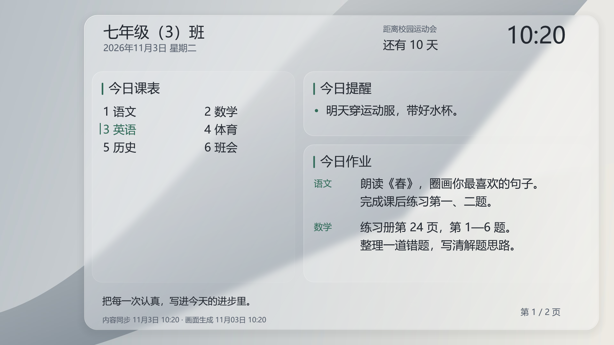
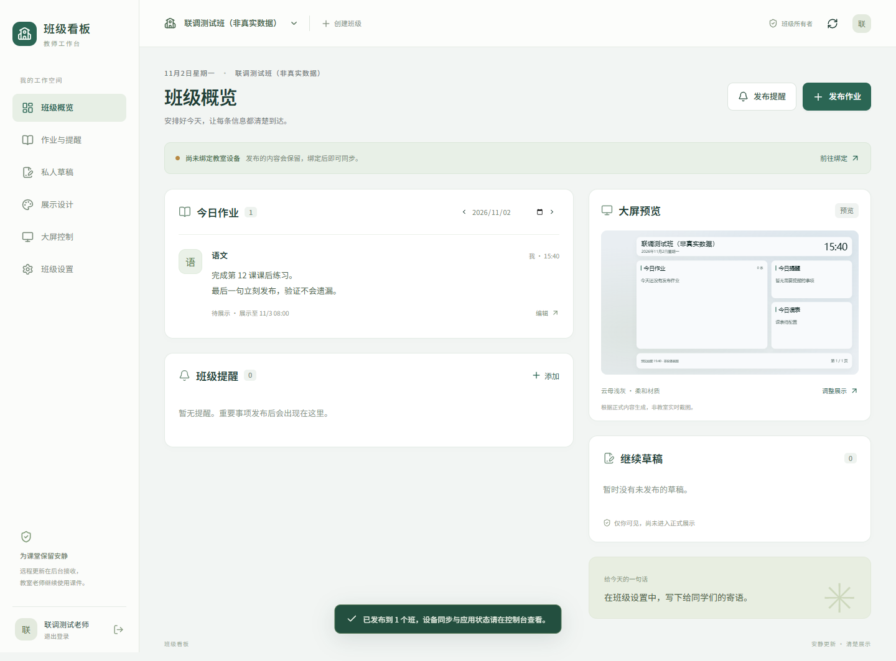
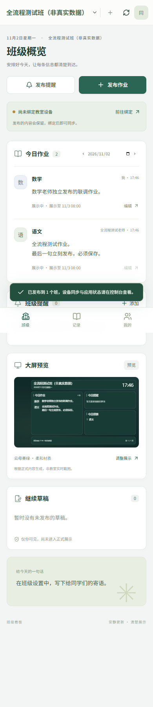
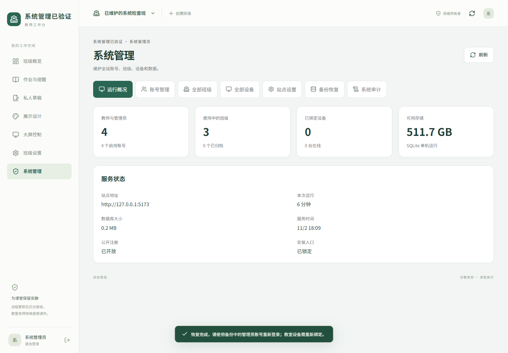

# ClassGlow 使用说明

当前是“手机 / 电脑 Web 管理端 + Windows 教室客户端 + Linux 服务端”。Android 手机和 iPhone 都通过浏览器操作同一个网页，没有独立 Android APK、iOS App 或小程序。部署后管理地址为 `https://teacher.dgplus.vip/`。

## 从安装到第一次展示

1. 部署人员读取管理员激活码，把 `/setup` 入口交给学校管理员。管理员只填写账号、密码、激活码；老师首页始终是登录 / 首次激活。
2. 管理员登录后进入“系统管理 → 开通账号”，选择班主任或普通老师，设置账号有效期，并为普通老师分配班级、学科。生成的激活码交给对应老师。
3. 老师首次打开网站，选“首次激活”，输入账号、自设密码、激活码。以后只需账密登录。身份和班级由管理员分配，无需老师选择或配置服务器。
4. 班主任可创建、管理自己负责的班级，维护课表、提醒、寄语和任教学科；普通老师只维护自己被授权的学科内容。
5. 在教室 Windows 电脑安装 [Windows 0.3.0 客户端](https://teacher.dgplus.vip/downloads/ClassGlow-0.3.0-win-x64-setup.exe)，从开始菜单打开并阅读首次隐私说明。服务地址默认为 **`https://teacher.dgplus.vip/api/`**，生成 6 位设备绑定码。
6. 班主任进入“大屏控制”输入绑定码、核对教室并确认。设备绑定码只用于绑定电脑，与账号激活码、高级许可码无关。绑定和自动同步免费。
7. 回到 Windows 客户端，核对目标屏幕，在本机启用展示；启用前不写入壁纸。老师发布的正式内容会自动同步。
8. 需要高级功能时，向管理员领取绑定本人账号的许可码，在“账号与许可”兑换。手机入口为“我的 → 账号期限与高级许可”。

基础免费：作业、提醒、课表、默认看板和基础同步。高级许可：自定义背景 / 布局、多班批量发布、远程大屏控制。身份仍决定可操作的范围，普通老师兑换许可不会变成班主任。期限区别与续期规则见 [账号与许可说明](ACCOUNT-LICENSES.md)。

## 老师每天怎样操作

| 需求 | 操作 |
| --- | --- |
| 发作业 | 选班级 → 发布作业 → 选学科、填写正文与时间 → 发布；在许可期内且对各班有学科权限时，可一次发布到多个班 |
| 临时通知 | 班主任发布提醒 → 设置时间与优先级 → 发布 |
| 中途没写完 | 保存私人草稿，之后继续；自动保存只保存草稿，不会自动公开 |
| 修改或撤回 | 从作业与提醒记录进入编辑、撤回；代改他人正式内容需要权限与原因 |
| 调课 | 班主任进入班级设置 → 每周课表或指定日期调整 → 明确发布 |
| 调整大屏外观 | 展示设计 → 上传背景或选择底色 → 调整卡片通透度 → 在大卡片内部拖动 / 拉伸小卡片 → 发布布局与主题 |
| 检查教室设备 | 大屏控制 → 查看在线状态、已缓存版本、已应用版本，以及命令执行结果 |
| 手机进入更多设置 | 底部“我的” → 私人草稿、班级设置、大屏控制；普通老师只显示自己有权限的入口，系统管理员还会看到系统管理 |

手机浏览器可把网站添加到主屏幕作为快捷入口。当前没有完整应用离线启动能力；已打开页面的未同步输入可以暂存在本机，恢复网络后仅同步草稿，发布仍由老师确认。

## 实际呈现效果

管理端以浅色卡片、墨绿色按钮和清晰的内容分区呈现。电脑左侧提供完整导航；手机使用底部“班级 / 记录 / 我的”，主操作集中在班级页。教室看板支持浅灰和深灰云母、三档字号、自定义背景及长内容翻页。

### 自定义 Windows 大卡片

具有有效高级许可的班主任或系统管理员进入“展示设计”。外层大卡片统一承载背景模糊与高光边缘，内部作业、提醒、课表可独立调整：

1. 选择“作业优先”“均衡分栏”或“课表在左”作为起点。
2. 拖动卡片移动，拖动右下角拉伸；手机可直接选择宽度、高度与留空位置。可关闭暂时不用的卡片。
3. 观察上方预览和页数。小卡片尺寸固定，内容增加时自动分页；模块重叠时会提示，调整后才能发布。班级标题、时钟、倒计时与底部栏的位置固定，支持显隐。
4. 在“背景与通透度”上传 JPG / PNG / WebP（最大 8 MB），或选纯色底色。图片自动居中裁切为 16:9 并压缩；默认卡片不透明度为 38%，也可改为完全不透明的纯色材质。
5. 点击“发布布局与主题”。修改先保留在预览中，发布后才会进入设备快照；设备回到桌面后应用。图片与布局同样保留在离线缓存和数据库备份中。

Windows 正式渲染器输出的示例（图片背景 + 课表在左，示例数据）：

目前 Windows 使用合成壁纸，玻璃效果来自背景模糊、半透明叠色与亮边，不包含 macOS 的实时折射或交互动画。

以下是 2026 年 11 月 2 日本地联调截图，账号和班级为明确标记的测试数据；不是公网已部署的页面，也不是教室电脑实时截屏。

电脑教师端：

手机教师端：

系统管理员后台：

## 大屏更新与当前完成程度

客户端正常每 10 秒拉取一次正式快照，每 30 秒上报状态；这些是轮询间隔，不是所有网络环境下的送达保证。设备页将“已缓存”和“已应用”分开显示。课件或视频仍在前台时，客户端继续缓存并报告延后，不主动切换桌面；回到桌面后再尝试更新。这里的展示是 Windows 桌面背景，课件全屏期间不会覆盖课件。

首次初始化、系统后台、教师内容管理、移动端布局、设备配对和同步已完成关键流程联调，适合开始试点。真实教室长时间运行、多屏 / DPI、学校还原保护、重启持久化和真实手机兼容性仍需现场验收；当前 Windows 包为未签名的开发测试包，没有客户端自动升级。详细验证边界见 [验证记录](VERIFICATION.md)。

Windows 0.3.0 支持离线许可到期时自动使用默认看板；0.2.0 需联网收到默认快照才降级，应升级安装包。

Linux 一键部署更新的是服务端和 Web 管理端；教室 Windows 客户端仍由管理员退出程序后运行新版安装包，个人绑定数据保留在当前 Windows 用户目录中。

卸载可从 Windows“设置 → 应用 → 已安装的应用 → ClassGlow 班级看板”发起，也可从客户端托盘选择卸载。程序先停止同步并恢复仍由自己占用的壁纸，再清理自己的文件、凭证、缓存、日志、启动项及快捷方式。离线时会明确提示是否继续本机卸载；继续后由老师在网页撤销原设备。详细位置、旧便携版处理和清理边界见 [隐私与卸载说明](WINDOWS-PRIVACY.md)。
