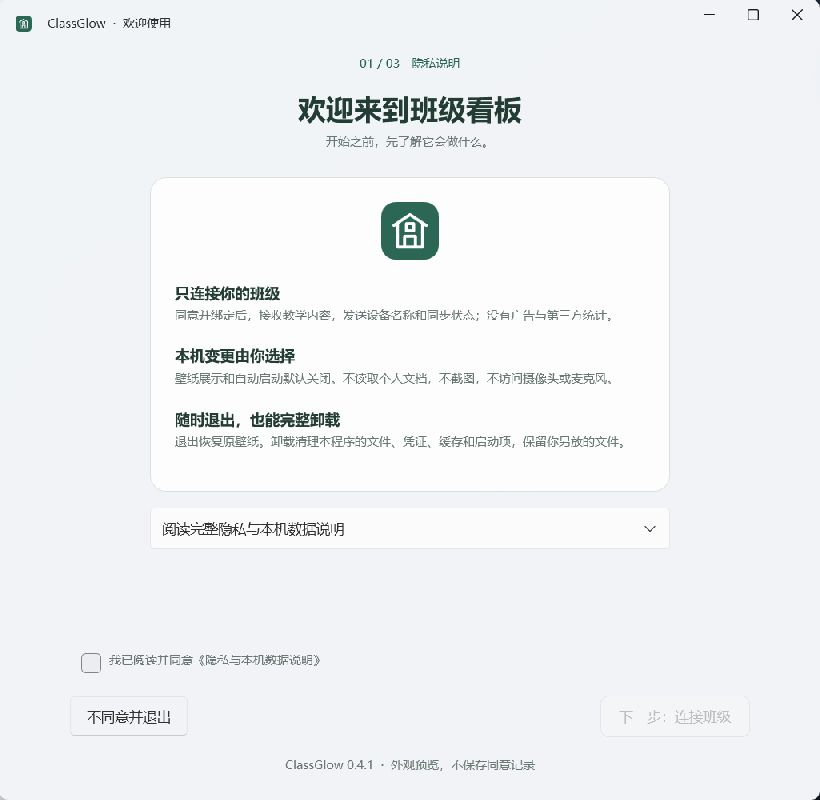
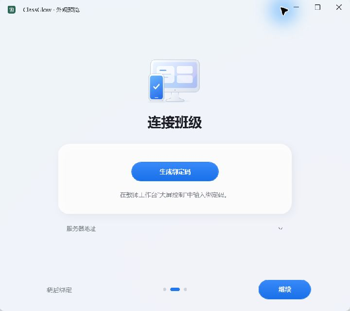
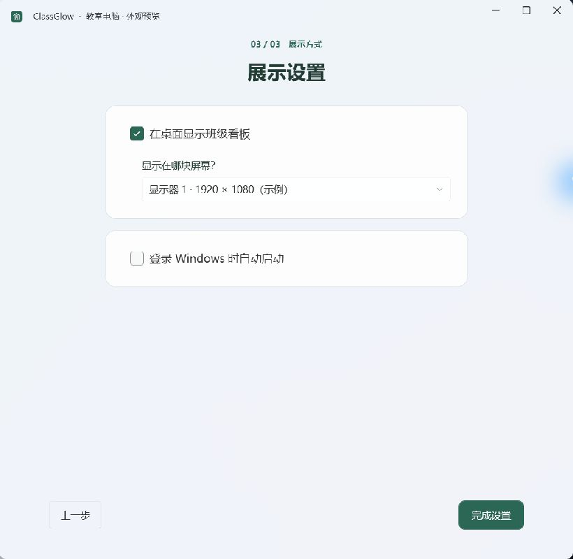
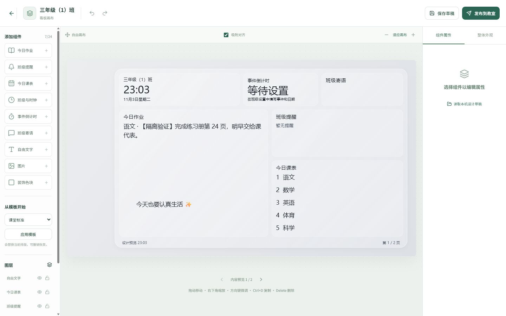
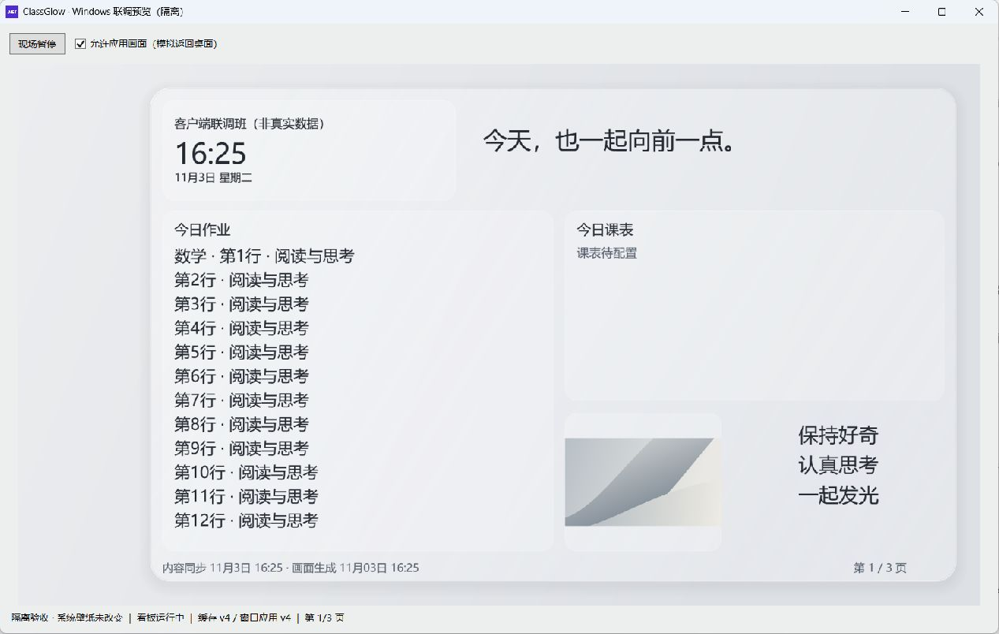
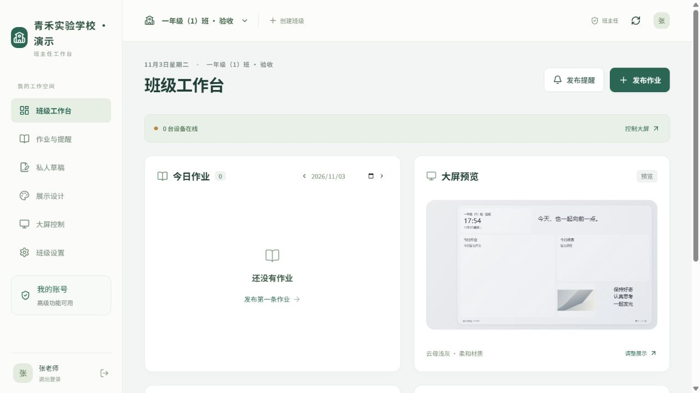
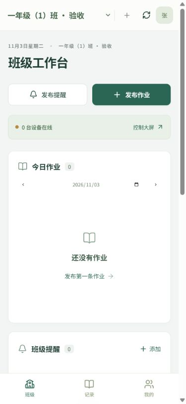
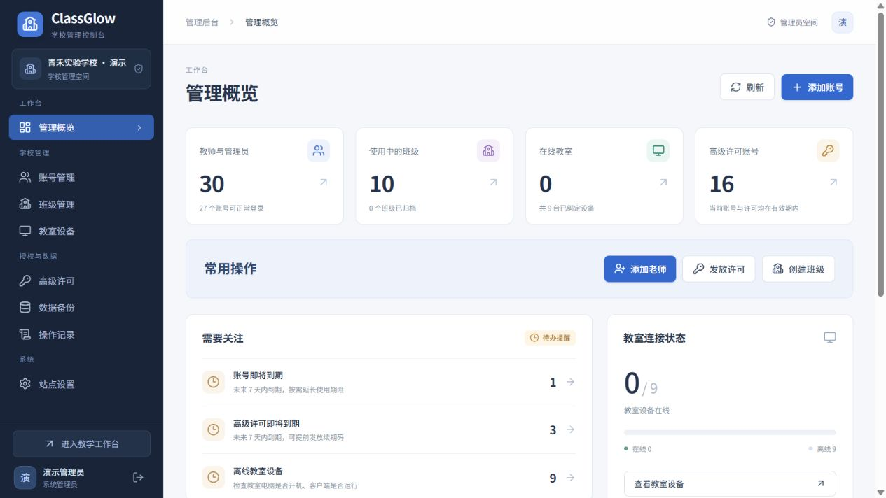

# ClassGlow 使用说明

## 0.4.12 使用入口

- **连接教室电脑**：Windows 生成绑定码 → 网页“教室电脑”输入绑定码并命名 → 在 Windows 启用展示。每台电脑单独绑定；办公电脑和手机使用网页。名称可在“当前电脑 → 改名”修改，客户端也显示相同名称和编号。
- **多台电脑**：发布作业与画布会同步到当前班级全部已绑定电脑；查看画面、暂停、翻页、醒目提醒只作用于选中的一台。首页列出各台状态；“操作指引”可随时重看。
- **同步**：在线新版客户端收到更新通知后自动取回内容，断线保留 10 秒轮询。网页区分接收、生成、已展示、离线和全屏课件暂缓。普通窗口不再挡住背景同步；首次玻璃材质生成仍可能花几秒，暂停和 Wallpaper Engine 冲突仍需解除。
- **高中和自定义学科**：创建班级时选择学段，自动填入学科。已有班级到“班级设置 → 班级资料与学科”点击“补全高中学科”，或输入自定义学科后点“添加”，最后保存。普通教师按班主任分配的学科发布。
- **保持登录**：默认新会话有效期 30 天，关闭浏览器后仍保留。已有短期会话需重新登录一次才能取得新的 30 天会话；主动退出、密码重置、账号到期或原有换端登录规则仍会使会话失效。共用电脑用后退出。
- **手机画布**：触摸组件移动，拖动四条边或四个角改变大小；手势中轻量预览，松手后恢复玻璃并保存草稿。撤销一次回到整次手势前的位置，取消触摸不提交半截操作。
- **醒目提醒**：“教室电脑 → 选择电脑 → 醒目提醒”，选择跑马灯、弹幕、全屏弹窗或倒计时，填写内容、颜色和时长，发送到明确显示的目标。此功能属于高级远程控制。默认避开全屏课件，可明确勾选覆盖全屏。到时自动结束，现场关闭按钮/托盘和网页停止按钮均可提前结束。暂停或未启用的客户端不播放，过期提醒不补播；新版替换同一电脑的旧提醒。底层看板回传不包含临时提醒或其他窗口，播放状态另行显示。

以上即时同步与醒目提醒需要 Windows **0.4.12**。从[下载页](https://teacher.dgplus.vip/download)下载，先退出旧版托盘，再覆盖安装到原目录；绑定和数据保留。手动打开后确认修订后的隐私说明（2026-11-04.4），即可继续使用，不要先卸载。

## 0.4.11 Windows 展示修复

从[下载页](https://teacher.dgplus.vip/download)取得 0.4.11，先退出托盘中的旧客户端，覆盖安装到原位置，再手动打开并确认更新后的隐私说明。原有班级绑定保留，更新不要先卸载。

本版去除玻璃卡片的深色外阴影，网页和 Windows 使用同一套细边高光。检测到 Wallpaper Engine 时，请从其托盘菜单选择“退出”，再点击看板里的“我已退出，重新检测”。冲突期间作业继续同步，桌面应用暂缓；退出后回到桌面或看板设置窗口恢复展示。

在网页“看板画布”选择玻璃卡片并发布，教室电脑同步后使用新的玻璃材质；添加背景图片更容易看到通透和折射。首次生成可能需要几秒，期间保留已有画面；之后修改作业和翻页复用材质。底图最高按 1080p 处理，4K 屏幕的正文仍按实际分辨率绘制。

电脑较旧或更看重性能时，可在客户端托盘菜单切换“减少材质效果”。系统不支持透明或缺少 WebView2 时也会使用兼容材质，教学内容仍可同步。设置窗口在受支持的 Windows 上使用云母背景。

## 0.4.9 画布与内容控制

教室电脑需退出旧版并安装 0.4.9，原绑定保留。网页版更新后即可使用新的编辑控件，Windows 新材质与独立内容需要新版客户端。

- 底板固定铺满整个显示器，内部卡片可自由移动、缩放和叠放。在“从模板开始”选择 Bento 分区并应用，可获得主次分明的排版；应用会替换当前排版，支持撤销。
- 选中作业框，在“绑定学科”中选择数学等学科，该框只显示对应学科已发布的作业；选“全部学科”会显示独立学科标签。长作业自动分页，不会把卡片向下撑大。
- 选中寄语或倒计时，切换到“独立内容”后编辑这张卡片的文字或事件；选择“跟随班级”则继续使用班级统一设置。
- 卡片风格可选柔光玻璃、素白纸张、静谧深色，仍可调整背景图片、透明度和字体。网页玻璃折射与 Windows 静态壁纸材质存在差异，实际展示以“教室电脑 → 刷新画面”的回传为准。
- “发布记录”中的删除会同时删除该条内容的修改历史。普通老师只能操作权限范围内的内容；删除后不能通过网页撤销，服务器旧备份中的副本仍会保留。
- 下拉选择器可直接点击，也支持方向键、Home / End、回车与 Esc；日期中的年月菜单按一次 Esc 返回日历，再按一次退出日历。

## 0.4.8 教师界面、卡片背景与字体

本版同步更新前端、API 和 Windows 客户端。教室电脑退出旧版并安装 0.4.8 后，可显示新的字体、图形和卡片背景。配置沿用布局 JSON。

- 教师工作台、登录页与画布工具沿用下载页的灰白底色、蓝色操作按钮和圆角。教学内容卡片保持固定高度，长内容在卡片内部滚动。
- 进入“看板画布”，选中一个组件，在“字体与排版”选择黑体、宋体或楷体，调整正文与标题字号、粗细、行距、文字颜色和左/中/右对齐。也可先选“正文 / 标题 / 寄语”样式再微调。文字超过卡片容量时分页，字号变化会重新计算行数。
- 组件属性中的“卡片背景图片”只改变这个组件；“整体外观 → 大底板背景图片”改变外层底板。二者均支持铺满或完整显示、居中或向四边对齐、调整遮罩和移除图片。桌面背景另设，上传卡片图片不会替换它。
- 接受 8 MB 以内的 JPG、PNG、WebP，上传前压缩为不携带原始照片元数据的 JPEG，随布局同步与缓存。取消发布前属于编辑草稿。
- 字体使用设备已有的中文字体，未额外安装字体。黑体优先使用微软雅黑 UI，宋体使用 SimSun，楷体使用 KaiTi；系统缺少字体时回退，因此仍以教室电脑回传的实际画面为准。本版没有任意字体文件上传。

## 0.4.8 管理员公告

在“管理后台 → 公告管理”填写标题和 Markdown 正文，右侧预览实际排版。选择“全体账号”，或选择“指定账号”后按姓名、账号搜索并勾选接收人，点击发布。支持标题、列表、加粗、表格和链接。

每个账号每条公告自动弹出一次，弹出记录保存到服务器。刷新、重新登录或换浏览器后仍按账号去重。在线网页每 30 秒检查，首次引导结束后继续检查。全体公告在撤回前也覆盖新开通的账号，管理员可在发布记录中查看已弹出人数并撤回。公告在教师与管理员网页弹出。

## 0.4.7：首次打开兼容性更新

如果旧版第一次打开时整窗空白，先在任务管理器结束 `ClassroomBoard.exe`，再从[下载页](https://teacher.dgplus.vip/download)重新下载 0.4.7，安装到原位置并手动打开。不需要先卸载或删除班级绑定。若出现启动错误对话框，将其中的错误类型、错误码及本机 `startup.log` 交给管理员；日志不会自动上传。若仍整窗空白且没有错误提示，记录 Windows 版本和客户端版本后反馈，不能以“没有日志”认定运行正常。

## 0.4.6：查看教室当前看板与备份管理

1. 教室电脑先退出旧版，安装 0.4.6，手动打开并阅读新的隐私说明。原绑定与班级数据保留。
2. 班主任在首页点击“查看当前看板”，或进入“教室电脑”，点击“刷新画面”。在线电脑通常在 10–20 秒回传本程序实际设置的看板，可放大查看。
3. 页面标明回传时间、页码、“电脑版本 / 最新发布版本”。其他老师发布后，刷新会重新取得班级内容与电脑画面；尚未应用、离线、暂停或超时会分别提示。回传是快照，不是视频监控，也不包含课件或其他窗口。
4. 同班普通老师可查看画面，但不能绑定设备、暂停或翻页。查看属于基础功能；高级远程控制的权限不变。画布仍有独立草稿与修订冲突提示，此功能不等于多人同时拖动的协同编辑器。
5. 管理员“数据备份”中显示来源、时间和大小，详情显示备份内各类记录数量。删除只删除选定副本，需确认；恢复仍需要管理员口令并先保留当前数据。
6. 日期字段统一使用日历：可选年月、点击日期、用方向键移动，也可直接输入 `2030-12-03`；时间字段输入 `2030-12-03 08:00` 或在日历内选择时分并确定。

当前是“手机 / 电脑 Web 管理端 + Windows 教室客户端 + Linux 服务端”。Android 手机和 iPhone 都通过浏览器操作同一个网页，没有独立 Android APK、iOS App 或小程序。部署后管理地址为 `https://teacher.dgplus.vip/`。

## 从安装到第一次展示

1. 部署人员在服务器运行 `sudo classglow`，选择“初始化管理员”，设置管理员账号和密码。服务器操作只出现在运维菜单中。
2. 管理员登录网站，进入“账号管理 → 添加账号”，设置老师姓名、登录账号、初始密码、身份、有效期及任教班级和学科。
3. 老师打开网站，输入管理员给的账号和密码，直接进入自己的工作台。没有注册或首次激活步骤，忘记密码联系管理员重置。

4. 班主任可创建、管理自己负责的班级，维护课表、提醒、寄语和任教学科；普通老师只维护自己被授权的学科内容。
5. 在教室电脑安装 [Windows 客户端下载页](https://teacher.dgplus.vip/download)，从桌面或开始菜单打开。第一步阅读隐私说明，第二步生成 6 位绑定码。服务地址默认已填好，通常无需修改。
6. 班主任进入“教室电脑”输入绑定码、核对教室并确认。设备绑定码只用于绑定电脑，与高级功能激活码无关。绑定和自动同步免费。
7. 绑定成功后点“继续”，选择是否在桌面展示、展示在哪块屏幕及是否自动启动，再点“完成”。两项默认关闭，勾选时尚不生效。
8. 需要高级功能时，向管理员领取绑定本人账号的许可码，在“我的账号 → 开通高级功能”填写。手机入口为“我的 → 账号与高级功能”。

基础免费：作业、提醒、课表、默认看板和基础同步。高级许可：自定义背景 / 布局、多班批量发布、远程大屏控制。身份仍决定可操作的范围，普通老师兑换许可不会变成班主任。期限区别与续期规则见 [账号与许可说明](ACCOUNT-LICENSES.md)。

## 教师首页与初次引导

班主任首页保留“发作业、发提醒、设计看板、教室电脑”四个常用操作，下面显示正在展示的内容和今日课表；普通老师只看到发作业、发布记录和草稿箱。内容卡片固定高度，长内容在卡片内滚动。发布默认当前班级，主要填写科目和正文，修改时间和截止日期时再展开设置。

首次登录有高亮实际按钮的分步引导，支持上一步、下一步和跳过。顶部问号或手机“我的 → 使用引导”可以重看。班级设置按课表、寄语与倒计时、班级成员、数据与记录分开。

## 下载、关闭与退出

将 `https://teacher.dgplus.vip/download` 发给老师即可。下载无需登录；登录页底部、工作台侧栏和手机“我的”中也有入口。页面自动显示当前发布版本，Windows 程序需下载并安装新版本才会更新。

0.4.5 安装包支持选择新文件夹（含中文与空格）及桌面快捷方式。安装位置默认在当前用户目录，升级沿用原位置；换位置请先卸载旧版，再安装并重新绑定。卸载入口包括客户端“卸载软件”、安装目录 `Uninstall.exe`、开始菜单及 Windows 已安装的应用。

0.4.4 开始，主窗口的关闭按钮和最小化按钮都将程序收起到右下角系统托盘，不在任务栏保留窗口。点击托盘图标或从开始菜单重新打开程序即可返回。完全退出请选择托盘右键菜单“退出并恢复原壁纸”；更新安装前也请先这样退出。图标可能被 Windows 收入托盘的隐藏图标区域。

## Windows 首次打开

首次配置分为三页，自建服务的地址可展开“服务器地址”修改。新绑定尚未完成展示设置时，重开程序会继续第三步。已完成配置的用户直接看到班级与运行状态，展开“同步详情”才显示版本和分页信息；点“展示设置”可修改本机选项。

0.4.3 统一了三页的字体、圆角和操作按钮，展示与自动启动合并为同一组设置。默认窗口为 720 × 640，内容随可用高度居中；窗口缩小时内容可滚动，底部操作保持可见。设计参考 Apple 的[布局](https://developer.apple.com/design/human-interface-guidelines/layout)与[材质](https://developer.apple.com/design/human-interface-guidelines/materials)指南，使用 Windows 云母背景和原创矢量插图。

截图来自 Windows 11 上实际运行的客户端外观预览，示例班级不连接生产服务器，也不写入壁纸或启动项。

窗口使用 [WPF UI](https://github.com/lepoco/wpfui) 的 Fluent 标题栏与云母材质，第三方许可随安装包提供。此窗口材质与桌面看板合成壁纸是不同的显示方式。

## 老师每天怎样操作

| 需求 | 操作 |
| --- | --- |
| 发作业 | 选班级 → 发布作业 → 选学科、填写正文与时间 → 发布；在许可期内且对各班有学科权限时，可一次发布到多个班 |
| 临时通知 | 班主任发布提醒 → 设置时间与优先级 → 发布 |
| 中途没写完 | 保存私人草稿，之后继续；自动保存只保存草稿，不会自动公开 |
| 修改或撤回 | 从作业与提醒记录进入编辑、撤回；代改他人正式内容需要权限与原因 |
| 调课 | 班主任进入班级设置 → 每周课表或指定日期调整 → 明确发布 |
| 自由设计大屏 | 展示设计 → 展开画布 → 添加组件 → 拖动、缩放、编辑样式 → 发布到教室 |
| 检查教室设备 | 教室电脑 → 查看在线状态、已缓存版本、已应用版本，以及命令执行结果 |
| 手机进入更多设置 | 底部“我的” → 草稿箱、班级设置、教室电脑；普通老师只显示自己有权限的入口，系统管理员还会看到系统管理 |

手机浏览器可把网站添加到主屏幕作为快捷入口。当前没有完整应用离线启动能力；已打开页面的未同步输入可以暂存在本机，恢复网络后仅同步草稿，发布仍由老师确认。

## 实际呈现效果

管理端以浅色卡片、墨绿色按钮和清晰的内容分区呈现。电脑左侧提供完整导航；手机使用底部“班级 / 记录 / 我的”，主操作集中在班级页。教室看板支持浅灰和深灰云母、三档字号、自定义背景及长内容翻页。

### 用自由画布设计 Windows 看板

具有有效高级许可的班主任或系统管理员点击首页“设计看板”或侧栏“看板画布”，会打开独立页面 `/studio?class=班级编号`，并沿用当前登录。左边是组件与图层，中间是画布，右边是选中组件的属性。外层大卡片保留统一材质，内部布局由老师决定。

1. 从“课堂标准”“三栏平分”“灵感便签”开始，也可选空白画布。应用模板后可以撤销。
2. 点选组件添加到画布：作业、提醒、课表、班级与时钟、倒计时、寄语，以及自由文字、图片、装饰色块。数据组件随班级正式内容更新；自由文字可以直接编辑。
3. 拖动组件移动，拉右下角缩放，也可在属性面板输入位置和尺寸。组件可以叠放、复制、隐藏、锁定、调整图层顺序和文字样式。图层列表可以选中被其他组件遮住的内容。
4. 使用撤销/重做调整设计。方向键微调，Shift + 方向键移动更大步幅，Ctrl+D 复制，Delete 删除。默认启用吸附对齐；拖动时按 Alt 暂时取消吸附。
5. 每个组件有尺寸下限，最多添加 24 个；内容增加时分页显示，组件不会被长文字撑高。预览可切换内容页。手机先显示画布，下面通过“添加组件与模板 / 组件属性与外观”切换工具；精细排版建议使用电脑。
6. 在“整体外观”上传背景图片或选纯色，调整底板通透度。底板固定铺满显示器，内部组件使用完整画布，不再保留不可编辑的桌面图标区域。背景居中裁切；图片组件保留原始宽高比。上传支持 8 MB 内的 JPG / PNG / WebP，保存时会压缩并移除 EXIF。
7. 草稿保存在当前浏览器，点击“发布到教室”并确认后才同步。Windows 回到桌面时应用，图片与布局包含在离线快照和数据库备份中。

自由画布需 Windows **0.4.0 或更新版**。旧客户端暂时使用基础看板，教室电脑页显示版本和升级提示；客户端升级后会自动重新取得完整设计。许可到期仍保留设计，设备按原有规则回到基础看板。

实际设计室截图（独立测试班级）：

Windows 0.4.0 真实程序在隔离联调窗口中显示同一设计，窗口内的缓存、应用版本和分页均来自实际客户端：

目前 Windows 使用合成壁纸，玻璃效果来自背景模糊、半透明叠色与亮边，不包含 macOS 的实时折射或交互动画。

以下截图来自本地独立测试数据库，账号和班级均为演示数据，不是生产学校数据。

电脑教师端：

手机教师端：

系统管理员后台：

## 大屏更新与当前完成程度

客户端正常每 10 秒拉取一次正式快照，每 30 秒上报状态；这些是轮询间隔，不是所有网络环境下的送达保证。设备页将“已缓存”和“已应用”分开显示。课件或视频仍在前台时，客户端继续缓存并报告延后，不主动切换桌面；回到桌面后再尝试更新。这里的展示是 Windows 桌面背景，课件全屏期间不会覆盖课件。

首次初始化、系统后台、教师内容管理、移动端布局、设备配对和同步已完成关键流程联调，适合开始试点。真实教室长时间运行、多屏 / DPI、学校还原保护、重启持久化和真实手机兼容性仍需现场验收；当前 Windows 包为未签名的开发测试包，没有客户端自动升级。详细验证边界见 [验证记录](VERIFICATION.md)。

Windows 0.3.0 支持离线许可到期时自动使用默认看板；0.2.0 需联网收到默认快照才降级，应升级安装包。

管理员拥有独立后台，包括管理概览、账号管理、班级管理、教室设备、高级许可、数据备份、操作记录和站点设置。账号可按身份、可用状态、许可状态筛选；编辑在侧栏完成。老师使用教学工作台，首页同一排卡片宽高统一，长列表在卡片内滚动。

Linux 一键部署更新的是服务端和 Web 管理端；教室 Windows 客户端仍由管理员退出程序后运行新版安装包，个人绑定数据保留在当前 Windows 用户目录中。

卸载可从 Windows“设置 → 应用 → 已安装的应用 → ClassGlow 班级看板”发起，也可从客户端托盘选择卸载。程序先停止同步并恢复仍由自己占用的壁纸，再清理自己的文件、凭证、缓存、日志、启动项及快捷方式。离线时会明确提示是否继续本机卸载；继续后由老师在网页撤销原设备。详细位置、旧便携版处理和清理边界见 [隐私与卸载说明](WINDOWS-PRIVACY.md)。
