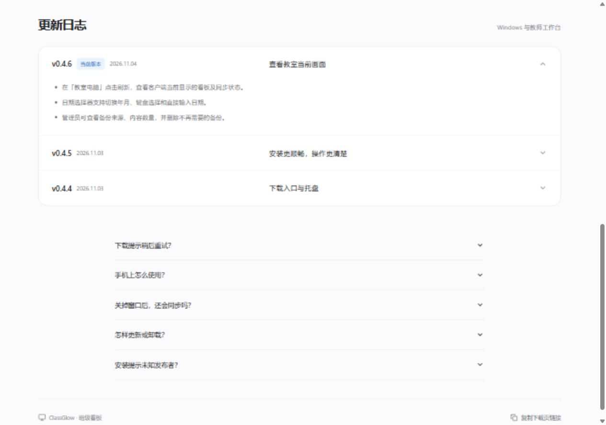
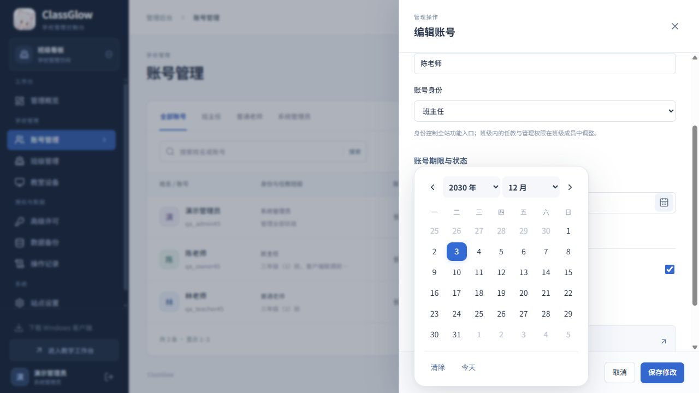
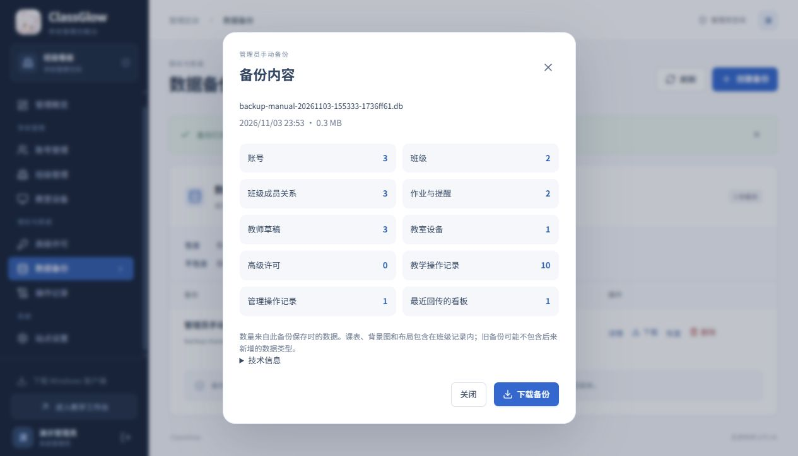
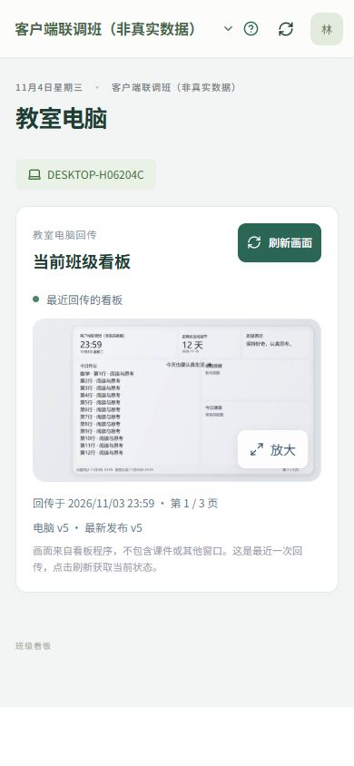
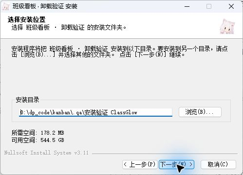
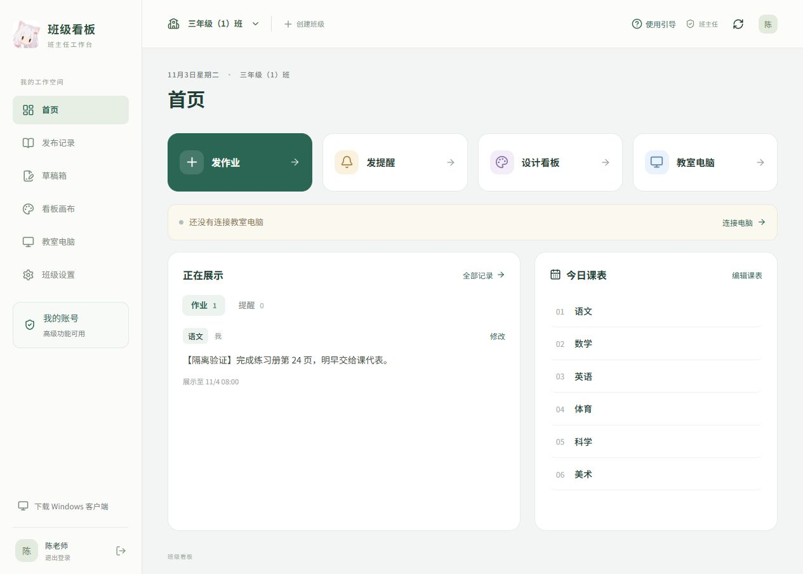
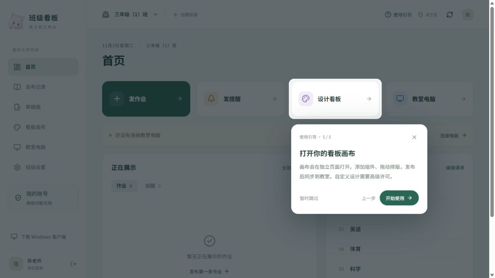
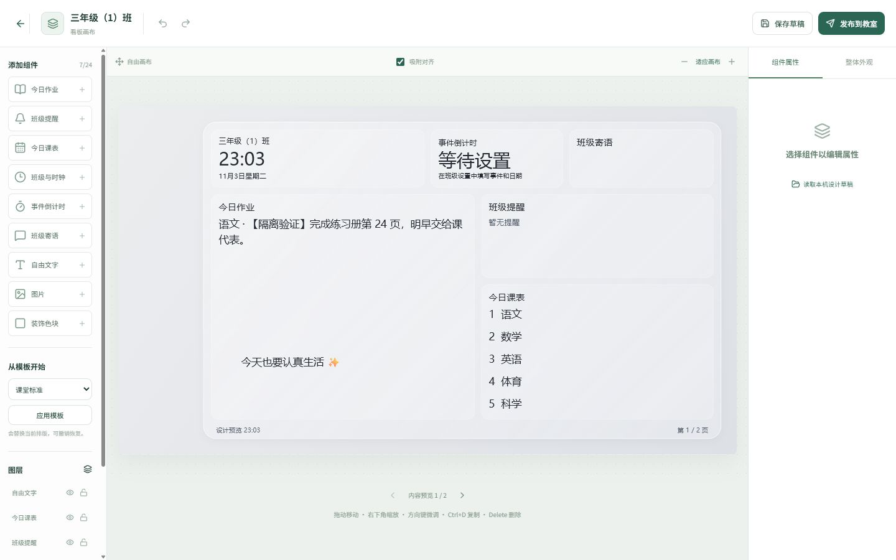

# 班级看板开发验证记录

## 2026-11-06 · 0.4.18 离线课堂工具箱

- 课堂工具检查扩展为 28 项，覆盖旧名单迁移和 DPAPI 保存、跨班数据与抽签轮次隔离、失败保存回滚、班级/名单上限、缺席排除、积分撤销及边界、座位完整性/锁定/过道/随机交换/PNG 导出、任务公平轮换与换人、CSV 引号与中文编码、同名与空姓名、Excel 多表/共享文本/稀疏列/学号补零/未计算公式拒绝、XML 外部实体及解压大小限制、浮层锁屏与退出清理，以及实际 WPF 分组→积分→座位→轮值流程。
- Windows 原生隔离窗口已实际操作：Excel 姓名/学号列识别及 `001` 前导零保留、分组送积分板、加分与撤销、座位网格及鼠标拖动换座、白板书写与 Ctrl+Z、遮挡框创建与双击移除、框选生成钉图、钉图放大与关闭。发现并修复拖动换座失效和透明浮层鼠标穿透问题。
- 钉图界面验证使用注入的虚构测试位图，未读取真实桌面；其他检查也使用隔离状态和虚构名单，没有改真实壁纸、用户绑定或向教室发命令。真实屏幕捕获、实体多屏/DPI、触控笔、低配教室长期运行及现场安装升级仍需现场验收，不能以隔离测试替代。
- 用法见 [使用说明](USAGE.md)，手动文件导入与截图用途、保存及卸载边界见 [隐私说明](WINDOWS-PRIVACY.md)。
- 最终 0.4.18 自带运行时的发布目录执行 28 项课堂工具、23 项时钟、5 项可靠性、24 组排版及 2 项时间检查，全部通过；前端 21 项测试、类型检查和生产构建通过。安装包 53,822,265 字节，SHA-256 为 `871f049a3f436d0e891a7ba1fb06082633c061618713169da834ee5b5a0e817d`，与发布清单一致。

## 2026-11-06 · 0.4.17 本地课堂工具

- 核对既有实现：网页下发的课堂倒计时已存在，本次复用原有计时与提醒窗口，补齐本机入口；新增随机点名、批量不重复抽签和均衡分组，入口在客户端首页和托盘。
- 13 项专项检查通过：名单边界和去重、整轮无重复与重置、允许重复模式的批内唯一、不同人数与组数的完整均衡分组、无效操作不改变名单与轮次、DPAPI 保存及重启读取、失败保存回滚、名单不进回报或诊断、离线/未绑定/暂停状态本地计时、时长校验、本地与远程停止隔离、锁屏及退出清理、实际 WPF 面板保存/抽取/分组/启动/停止流程。
- 原有 23 项时钟、5 项可靠性、24 组排版及 2 项时间检查通过；Windows Release 编译无警告和错误。专项检查已加入 Windows CI。检查数据、画面和状态使用隔离目录，未修改真实壁纸、系统时间或用户绑定。
- Windows 原生工具窗口已实际点击验证：点名后剩余名额由 8 减到 7；8 人分为 4 组，每组 2 人且不改变抽签轮次；本地计时入口可启动、停止并更新状态。使用虚构名单及隔离提醒出口，没有向真实教室发命令。
- 名单数据只在明确保存后写入本机加密状态文件；本地倒计时不新增接口、数据库迁移或后台服务。完整用法见 [使用说明](USAGE.md)。
- 最终 0.4.17 自带运行时的发布目录再次执行 13 项课堂工具、23 项时钟、5 项可靠性、24 组排版与 2 项时间检查，全部通过。Windows 与 Web/API 的 [远端 CI](https://github.com/2021Dt/ClassGlow/actions/runs/42172863324) 全部通过。
- 106 已发布 `v0.4.17` / `2b64e9e`；停写备份、数据数量、设备绑定、同步世代、完整性及服务健康检查通过。公网版本接口、静态资源、401 保护与 Range 下载正常；隔离 Edge 验证 0.4.17 下载按钮、更新日志、390px 无横向溢出及登录页，无页面错误。安装包校验值与备份位置见 [部署记录](DEPLOYMENT.md)。
- 公网完整下载 53,769,442 字节，SHA-256 与本地包、发布清单和服务器一致。
- 现场设备仍上报 0.4.11，需按客户确认的方式由现场人员覆盖安装 0.4.17；此记录不代替真实教室的长时间、实体多屏与安装升级验收。

## 2026-11-06 · 0.4.16 生产部署与倒计时复核

- 用户确认部署后，Windows 与 Web/API 的远端 CI 全部通过；106 已发布 `v0.4.16` / `5c3a0f9`。停写备份、业务数量、设备绑定、同步世代、数据库与健康检查通过；无新增迁移。备份和安装包摘要见 [部署记录](DEPLOYMENT.md)。
- 公网首页、健康和版本接口、入口 JS/CSS、受保护接口的 401、安装包 Range 及完整 53,744,440 字节下载通过；安装包 SHA-256 与本地及服务器一致。无代理的隔离 Edge 会话验证下载按钮、0.4.16 更新日志、390px 无横向溢出和登录页，未发现页面错误。
- 桌面日期倒计时使用北京时间日期差，普通时钟显示到分钟，均随桌面刷新链运行。课堂秒级倒计时使用独立 `DispatcherTimer`（250ms）和 `Stopwatch`，不以网络回包驱动每秒递减。
- 真实 `ScreenNotice` 的普通、自定义样式和自由画布三种窗口实测，均由 `00:04` 递减到 `00:03`，到期显示“时间到”，随后按既有 5 秒结束停留自动关闭。测试窗口放在全部物理显示器之外，未覆盖用户桌面、修改系统时间或真实壁纸；不冒充教室实体机长期验收。
- 部署后设备仍报告 0.4.11、缓存及应用内容均为 v19，仍有新联系记录，但展示状态为 deferred。客户确认由现场人员覆盖安装 0.4.16；服务器上线不等于旧客户端完成升级，故障现场复测仍待现场安装。

## 2026-11-06 · 0.4.16 桌面时钟排查与本地修复

现场反馈为“桌面一直可见时也不更新”。以下为部署前的排查记录，当时通过 Netcatty 只读检查 106；后续生产发布见上节。

- 106 的服务与下载包为 0.4.15，唯一未撤销且在线的设备上报 0.4.11。旧版 `SafeToApply` 仅放行桌面和本程序前台；普通窗口有焦点时会停止应用壁纸，即使桌面仍部分可见。这是与反馈最吻合的已确认代码问题，尚无该设备现场窗口状态记录来证明它是每次停更的唯一原因。
- 服务器已启用 NTP 并同步，时区 Asia/Shanghai，接口正常，SQLite `quick_check` 为 `ok`。北京时间 09:46:33–09:47:53 连续观察 80 秒，设备上报画面由 09:46:00 推进到 09:47:01，状态持续为 applied，联系间隔约 0.2–20.2 秒。观察期间没有复现停更；服务端自报时间不等同于实际屏幕验收。
- 在真实 C# Engine / Renderer 的隔离出口中，修复前六项回归全部失败：分钟边界延后、慢请求阻塞走时、系统时间回拨阻塞调度、304 不校时、下载素材耗时混入时差、退出全屏后仍等待旧刷新期限。已分别修复并回归。
- 最终时钟专项 23 项通过，另覆盖新内容延迟、慢心跳、系统时间前拨、旧服务兼容、断网与离线时效、同分钟不重写、暂停恢复、锁屏解锁、模拟 8 小时休眠、壁纸冲突、设置失败重试、跨日、退出取消、解绑后的迟到响应、材质创建超时的迟到清理、多屏及窗口阴影边界。
- 真实 1 秒循环连续运行 65 秒，首次快照故意等待 6.5 秒，两个分钟边界的画面更新延迟约 0.48 秒和 0.94 秒；等待网络时仍推进。该检查使用实际 Engine / Renderer 和假壁纸出口，不修改 Windows 时间或真实桌面，不代表低配教室的性能保证。
- 独立 SQLite / Uvicorn 服务与实际客户端再次联调，三次设置更新至生成画面为 1057、1067、1072 ms；四种提醒、目标全屏保护与恢复、远程停止、防重复执行通过，关闭 SSE 用时 2 ms。使用虚构账号和回环端口，无生产数据写入。
- 后端 68 项、前端 21 项、原生排版 24 个组合与 2 项时间检查、可靠性 5 项、网络 5 项地址检查及慢正文超时均通过；Ruff、前端类型检查 / 生产构建、Windows Release 编译、版本与契约检查通过。时钟专项已纳入 Windows CI。
- 最终打包目录再次执行时钟 23 项、可靠性 5 项、排版 24 个组合及 2 项时间检查，全部通过。安装包 `ClassGlow-0.4.16-win-x64-setup.exe` 为 53,744,440 字节，SHA-256 为 `a0643b89d21c86a0a63e8d721edf741745946075af1e63a929d246c00fd4898f`，已与同名 JSON 清单核对。
- 排查阶段先生成本地修复包，未替换客户客户端；无新增数据库迁移。后续生产发布见上节。需要客户覆盖安装后，验证普通窗口有焦点但时钟可见、断网、解锁 / 唤醒及连续运行。8 小时测试为模拟推进，多屏为几何判断检查，不冒充实体机长时间与多屏验收。

详细行为见 [可靠性说明](RELIABILITY.md)。

## 2026-11-05 · 0.4.15 可靠性修复

- 隔离回归新增：历史积累、未来内容缓存、素材鉴权与摘要校验、备份/迁移及逆迁移、并发幂等发布、写入期间读取、多端登录与单独撤销、提交失败不得误报成功。
- Edge 浏览器实际运行 320/390/768px 流程，覆盖登录、发布最终输入、离线草稿、筛选/页面刷新恢复与返回；另验证管理员网页开户、多端同时登录及撤销，5 项通过。
- 真实 C# 引擎与独立临时服务验证绑定、独立图片读取及快照缓存、同步回执与暂停延后，未写物理壁纸。原生安全排版 24 个组合、2 项时间检查及新增 5 项图片/诊断检查通过。
- 单进程 SQLite WAL、回环网络下，20 台隔离设备执行 180 次混合请求，零错误、40 次 304，P95 约 508ms，最长约 855ms；不代表公网容量或实体低配教室表现。
- 工作台主分块由约 234KB 降至约 47KB，入口全局样式由约 146KB 降至约 63KB；页面及相关样式按需加载。
- 版本与契约检查加入 CI；安装包附带大小及 SHA-256 清单。首次远端 CI 发现 Python 运行时下载超时与 Windows 锁文件运行时参数不匹配，流程改为使用明确配置的 Python 和一致的 `win-x64` 恢复、构建及自检；执行结果见仓库 Actions。
- 106 已完成 Linux Docker 构建、两项迁移及 0.4.15 切换，数据库完整性、业务数量、同步世代和既有设备同步通过核验。公网首页、下载页、静态资源、版本和安装包 Range 正常，受保护接口拒绝未登录访问；备份及摘要见 [部署记录](DEPLOYMENT.md)。
- 尚未执行实体教室连续 8 小时、学校还原保护及新包完整安装卸载验收。边界与现场步骤见 [可靠性说明](RELIABILITY.md)。

## 2026-11-04 · 0.4.12 设备协作与教师操作

- 线上部署完成并核对健康、0.4.12 版本、下载页更新日志和 EXE Range；数据数量保持，安装包全文件 SHA-256 一致。实际备份和权限记录见 [部署文档](DEPLOYMENT.md)。

- 隔离 SQLite 服务 + 实际 Windows Engine/Renderer，以生产相同的 1 秒 Tick 执行。三次更新从请求开始到本机完成画面生成为 1080、1056、1057 ms；关闭 SSE 仅用时 2 ms。测试替换壁纸写入出口，不改当前用户真实壁纸；使用减少效果模式，不包含首次玻璃材质冷启动或公网延迟。
- Windows 11 原生倒计时窗口已实看：标题、提醒正文、倒计时与关闭按钮正常，点击现场关闭后窗口消失。原生预览临时显示测试任务栏入口以供窗口检查；正式程序不显示提醒任务栏入口。
- 同一引擎验证四种提醒命令、全屏保护延后、解除保护后执行、远程停止和重复拉取不重播；提醒展示出口隔离，不能宣称所有多屏、DPI、游戏和课件组合已实机通过。
- 浏览器使用 390×844 触摸环境：拖动 24 次触摸移动期间草稿写入 0 次，松手后写入 1 次；八个缩放入口存在，右边缩放后左边保持。关闭并重启同一持久浏览器后仍登录；改名、手机横向无溢出、页面无 JS 错误通过。电脑页使用当前画面/醒目提醒/操作记录分页。
- 后端重点流程验证：默认 30 天会话，高中预设与自定义日语发布，提醒版本门槛、幂等防重、只作用指定设备、暂停拒绝与许可到期仍可停止；改名权限与快照更新、免费手动同步、提交后通知范围、回滚不通知及原回传流程通过。
- 前端类型检查/生产构建、离线材质构建与 Windows 编译打包通过。没有新增依赖或数据库迁移；原安装卸载边界沿用 0.4.11，本轮未再次全量执行安装生命周期测试。

## 2026-11-04 · 0.4.11 阴影、冲突与覆盖更新

- 网页实际 CanvasBoard 和 Windows 实际 GlassMaterial / Renderer 使用同一份演示快照，生成 1920×1080、3840×2160 图片；已检查卡片间没有原库的深色外投影。浏览器检查三块玻璃卡片的外阴影均为 none，卡片范围裁切为 hidden；保留原库折射和边缘高光。
- 实际 Engine 配合隔离壁纸出口完成 6 项检查：冲突不写壁纸、退出冲突恢复、冲突回传不带假画面、远程恢复延后且不提前消费命令序号、相同布局恢复后仍重新应用、回传恢复正常。没有在当前用户桌面实际运行 Wallpaper Engine，不能将隔离检查视为所有动态壁纸/多屏组合实测。
- Windows 11 实际安装独立 QA 包到中文带空格路径，再覆盖安装 0.4.11。DPAPI 状态文件逐字节不变，安装登记版本更新，旧版两个哈希材质文件删除，新资源及用户另放文件保留。
- 实际运行 QA 卸载器后，状态、材质缓存、同意记录、程序资源和卸载登记清除；安装目录及数据目录中另放的测试文件保留。验证使用独立产品标识、注册表及数据目录，没有触碰正式客户端绑定和真实壁纸。
- 前端类型检查、生产构建、离线材质构建和 Windows Release 编译通过。未修改数据库结构；安装包及清理范围见 [部署文档](DEPLOYMENT.md)、[Windows 隐私与卸载](WINDOWS-PRIVACY.md)。

## 2026-11-04 · 0.4.10 Windows 材质与资源占用

- Windows 自由画布实际加载离线 CanvasBoard 和 Liquid Glass React 1.1.1，捕获材质底图后关闭 WebView2 控制器；正文继续由 WPF 排版。材质最高 1920×1080，4K 输出保留原分辨率文字。图片背景、明暗卡片、1080p 与 4K 已生成并检查；缺失离线资源时继续生成原生兼容画面，减少效果不启动网页渲染。
- 已发布目录的 24 组排版、2 项时间检查与 12 项生命周期检查通过。生命周期检查包含新增 PNG / 校验文件 / WebView2 专用子目录的清理，以及保留用户另外放置的文件、子目录。安装包逐文件清单包含离线网页、SDK、许可与卸载入口。
- 独立本机服务通过实际 Engine / Renderer 执行同步、暂停、恢复、第 2 页和自动翻页，回执均为 executed。30 行作业生成 4 页，回传依次为展示、暂停无图、恢复后的展示。测试输出在隔离窗口，没有替换真实系统壁纸，没有连接生产账号。
- Windows 11 实看设置页，标题、关闭按钮和内容正常显示；云母在首帧后应用，保留软件绘制。前端生产构建、类型检查及已有 11 项用例通过。

性能环境：Windows 11 Pro 26200、Ryzen 9 9950X、32 逻辑线程、约 47 GiB 系统可见物理内存。使用发行版 DLL、真实同步与渲染、隔离壁纸出口；不包含设置窗口和托盘。下表是单个样例的观察值，不是低配硬件的性能保证。

| 场景 | 观察值 |
| --- | --- |
| 首次生成 1080p 材质及画面 | 约 4.56 秒；保持已有画面直到新图完成 |
| 1080p 在线待机 65.8 秒 | 主进程工作集 130–134 MiB，平均约 133 MiB；总 CPU 平均约 0.05%（按 32 线程计算） |
| 1080p 缓存后刷新，3 次 | 86–87 毫秒，工作集约 134–141 MiB |
| 4K 缓存后刷新，3 次 | 245–248 毫秒，工作集约 167–168 MiB |
| 4K 减少效果，3 次 | 116–123 毫秒，工作集约 155–159 MiB |
| 首次材质生成的主进程及 WebView2 子进程 | 50 毫秒采样，私有内存合计峰值约 356 MiB；工作集合计约 748 MiB，包含重复计算的共享页 |

首次生成期间的瞬时占用明显高于待机，不能用主进程的 133 MiB 代表整个生成过程。待机采样未发现本次材质渲染遗留的 WebView2 子进程。限制底图尺寸后，4K 与 1080p 同比例切换只生成一次材质；原先未限制的 4K 样例私有内存峰值约 872 MiB，已不采用。旧电脑可使用“减少透明效果”，但本轮没有在低配实体机验证最低配置，也没有替代原白屏故障机的现场验收。

隐私说明修订为 `2026-11-04.2`，升级需手动确认。新增缓存范围和清理行为见 [Windows 隐私与卸载](WINDOWS-PRIVACY.md)，安装包校验值见 [部署文档](DEPLOYMENT.md)。

## 2026-11-04 · 0.4.9 画布与内容控制

- 前端生产构建、类型检查与 11 项既有及分页用例通过；删除权限、修订冲突、历史清除、设备快照及自定义组件存储的 2 项后端链路检查通过。用例使用隔离数据库。
- 浏览器实测作业框绑定英语后不再显示数学作业，切回全部学科后显示独立学科标签；画布、底板、拖拽区域的四边一致。寄语编辑和深色卡片风格发布后重新打开仍保留；下载页署名与 390px 手机宽度正常。
- Windows 0.4.9 安装包生成成功，发布程序的 24 组排版及 2 项时间检查通过。取隔离服务的已发布设备快照交给正式渲染器，核对明暗主题、卡片标签、独立寄语与倒计时、1366×768 输出；100 行作业按固定卡片分页，共 12 页，没有修改系统壁纸。
- 首次展示修复允许本程序设置窗口在前台时应用壁纸，其他程序在前台时仍保持原有延后规则。原故障教室电脑上的首次启用和真实壁纸应用仍需安装新版后现场复测，本轮不将离线渲染等同于现场验收。
- 网页直接使用 [Magic UI](https://magicui.design/docs/components/bento-grid) 官方 BentoGrid / MagicCard 源码（仅调整导入路径）和 [Liquid Glass React](https://github.com/rdev/liquid-glass-react) 1.1.1，通过 React 组件嵌入 Vue。自行模拟的折射与悬停高光代码已移除；上游来源、文件摘要和 MIT 许可随仓库与网页分发。Windows 仍使用静态壁纸渲染，不运行 React 原库，不能将其静态亮边称为同等折射效果。
- 下拉框采用 Reka UI 2.11.0 的选择器与键盘焦点管理，统一细线箭头、圆角菜单与选中态；兼容原有表单校验和数字值。
- 浏览器实测官方组件插入、Bento 模板、玻璃背景图片、菜单键盘导航、日历数字年月与双层 Esc 退出；390px 宽度无页面横向溢出。原库玻璃尺寸已适配画布缩放。

## 2026-11-04 · 0.4.8 发布前验证

- 公告、账号安全、许可、画布与迁移的相关后端检查共 11 项通过，前端现有用例共 10 项通过。前端类型检查与生产构建通过，新增后端模块 Ruff 检查通过。
- 公告使用独立数据库实测管理员发布、指定接收人、Markdown 预览、手机端弹窗、首次引导结束后弹出及刷新去重。范围隔离、全体发布、领取重试与撤回由隔离 API 用例验证。
- Windows 0.4.8 自包含构建与 NSIS 安装包生成成功。最终发布目录执行 24 组排版与 2 项时间检查通过，并用组合画布快照生成明暗、纯色与 1366×768 预览。自由轮廓、动态文字、按科目筛选和字体在正式渲染器输出中生效，长内容样例生成 17 页。
- 本轮 Windows 验证使用正式发布程序的离线渲染入口。新版本的真实教室屏幕、多人控制与长期运行仍需现场验证；安装与卸载流程沿用此前已验收实现。
- 发布包大小和 SHA-256、迁移版本与运维方式见 [部署文档](DEPLOYMENT.md)，数据保留及移除范围见 [服务器清理](SERVER-CLEANUP.md)。

## 2026-11-04 · 教师界面与卡片外观（本地，未发布）

- 前端类型检查与生产构建通过；Windows Release 编译 0 警告、0 错误。相关前端分页用例 6 项和后端画布/背景链路 2 项通过，没有扩展运行无关测试。
- 使用 `.qa/appearance-review/review.db` 中的虚构教师、班级与设备，在真实教师工作台检查桌面及 390px 手机布局。首页卡片对齐、常用入口、手机底部导航可见，没有横向溢出。截图为 `.qa/appearance-review/teacher-home.png`、`teacher-mobile.png`。
- 从首页打开独立画布，实际上传组件背景，修改为宋体、48px、半粗、1.6 行距、右对齐、图片完整显示且靠下。通过发布按钮保存后重新打开页面，属性保留；独立读取 API 确认布局修订为 3，包含完整图片与排版设置。编辑器截图为 `.qa/appearance-review/studio-settings.png`。
- 将已发布的同一配置交给 Windows 正式 Renderer，生成明暗主题、纯色/通透及 1366×768 图片。截图确认卡片图片铺放、字体、粗细与右对齐生效；100 行样例的最后一页保留第 100 行，正文没有无限撑高卡片。输出在 `.qa/appearance-review/windows-published/`。
- 本轮没有修改真实用户壁纸、绑定、开机项，也没有安装或发布新客户端。0.4.7 的软件绘制和启动兼容修复保持不变；上述检查不等于完成远程教室现场验收。真实屏幕适配、可移动外层容器与完整数据绑定仍属于后续画布重构。

## 2026-11-04 · 0.4.7 首次打开兼容性

- 反馈环境为另一台 Windows 11：旧版首次打开整窗空白，标题与窗口按钮也不可见。2026-11-04 用户在原故障机更新到 0.4.7 后确认“可以正常看到并操作”，该机首次打开白屏的现场复测通过。未取得原故障日志，不能据此确定具体驱动或组件是根因。
- Windows Release 自包含发布、NSIS 打包、前端类型检查与生产构建通过。最终安装包哈希见部署文档。
- 本机 Windows 11 使用发布目录实看隐私、连接和展示设置三页；标题、按钮、正文均正常，预览勾选后可继续。另用独立产品标识的验证构建走真实 `Main` 首次启动入口，隐私页显示、拒绝后退出，不创建真实用户数据或联网。
- 既有托盘检查通过五项：关闭隐藏、唤回显示、最小化隐藏、唤回还原、显式退出关闭窗口与托盘，结果在 `.qa/tray-0.4.7.json`。
- 在隔离构建中临时移走 `Wpf.Ui.dll`，真实入口显示系统故障对话框并退出；`startup.log` 仅含版本、绘制模式、异常类型/错误码及应用方法名，没有异常正文或文件路径。验证结束恢复依赖，不改变正式程序。
- 本轮没有重新执行完整安装卸载或多人同步测试；安装器、网络同步及看板内容代码未改动。现场确认覆盖首次打开、标题按钮和隐私引导操作，不将其扩大为所有教室电脑或全部业务流程已验收。

## 2026-11-04 · 下载日志与限流

- 前端类型检查、生产构建与部署脚本 Bash 语法检查通过。
- 390px 手机视口没有横向溢出；展开旧版日志后列表保持 560px，内容内部滚动；1280px 桌面布局与当前版本标记正常，浏览器未记录页面错误。
- 在 106 的项目临时目录启动独立 Nginx 1.24.0，仅绑定回环端口，不改变正式网关。实际模板语法通过；单段 Range 返回 206 且字节与安装包头匹配，多段 Range 返回 416，HEAD 和教学健康接口正常。
- 同一 IP 连续 8 个小范围请求的状态为 `206 × 4、429 × 4`；更换查询参数和伪造 `X-Forwarded-For` 未绕过限制。429 为 UTF-8 中文页面，含 `Retry-After: 60`、`Cache-Control: no-store`，没有附件下载头。
- 两个同 IP 下载仍在传输时，第 3 个请求返回 429；8 个不同回环来源下载仍在传输时，第 9 个请求返回 429，并从隔离日志确认命中对应并发限制。
- 8 MiB 安装包片段在回环接口耗时 7.96 秒，符合 1 MiB/s 设置。测试流量留在服务器内部，结束后独立 Nginx 及其临时目录自动清理。没有运行公网压力测试或重打包 Windows。

## 2026-11-04 · 0.4.6 备份、日期与看板回传

- 前端生产构建、Windows Release 编译及 NSIS 安装包构建通过；安装包 SHA-256 见部署文档。
- 新增两项隔离后端用例：管理员备份详情和删除权限；同班查看、跨班拒绝、并发刷新合并、ETag 下发回传请求、过期状态回执拒绝、解绑后删除图片。另验证一次数据库迁移和四项既有控制/归档/修订用例，共 7 项通过；没有扩大为全量测试。
- 运行真实编译的 Windows 客户端，通过独立 SQLite 服务配对，执行渲染、同步、暂停、恢复、翻页与回传。实际回传 JPEG，暂停时返回空图片和暂停状态，恢复后再次取得画面。
- 两个隔离教师账号：普通老师发布新作业后，班主任读取到客户端已应用 v5 的画面，与服务器正式版本一致；普通老师可查看，但暂停请求返回 403。
- 浏览器检查备份数量详情、删除确认与取消，未删除生产备份；日历跨年选择、方向键选日、抽屉内弹层及 390px 手机边界正常。手机回传页无横向溢出，画面有固定比例和放大入口。
- 本次 Windows 联调使用隔离窗口承载真实渲染，没有替换系统壁纸；真实教室、多屏与长时间离线仍需现场验收。安装/卸载行为沿用 0.4.5 已验收流程，本轮未重复完整安装卸载。
- 联调首轮在现场暂停状态发生变化后拒绝了旧自动翻页命令，未伪报成功；重新隔离运行后全部上述流程通过。

## 2026-11-03 · 0.4.5 安装与教师流程修复

- `npm --prefix frontend run build` 通过（Vue / TypeScript 与生产构建）；Windows 自包含程序和 NSIS 安装包构建通过。
- Windows 11 原生安装器实际验证：安装说明中文正常，新建的 `D:\dp_code\kanban\.qa\安装验证 ClassGlow` 可安装，生成桌面快捷方式、`Uninstall.exe` 与当前用户卸载登记。卸载后上述登记、快捷方式及程序清除，目录里另放的 `保留文件.txt` 保留。使用独立 QA 标识，没有安装或卸载用户正式客户端。
- 重现并修复“新目录被拦截”：NSIS `GetFullPathName` 对不存在目录返回空串；改用 Windows `GetFullPathNameW`，仍禁止直接选择盘根、桌面根和文档根。
- 真实编译客户端 `--pairing-check`：进程内设置失效代理 `127.0.0.1:7890`，成功向 `https://teacher.dgplus.vip/api/` 请求 6 位配对码，并撤销该临时配对。未绑定生产班级，未修改系统代理、壁纸或启动项。
- 独立 SQLite 测试班级：班主任首次 5 步引导；发布一条作业后首页和记录可读；独立 `/studio` 页面继承登录，添加自由文字、修改位置尺寸、保存草稿、刷新恢复和发布成功。
- 普通老师首次为 3 步引导，导航只包含首页、发布记录和草稿箱，没有建班、设计和设备控制；发布科目仅显示被授权的数学。
- 390px 手机宽度检查首页、引导范围及关闭后刷新；画布改为先展示设计，下面切换组件与属性工具。1440px 检查三栏独立画布。
- 未重复全套历史测试。本轮未在真实教室验证物理桌面/PPT 切换、多屏壁纸恢复或长时间离线运行。

## 2026-11-03 · 0.4.4 下载页与托盘

- 前端类型检查与生产构建通过；公开下载页不加载登录工作台，也不要求账号。版本获取失败会显示重试入口。
- Windows 自包含发布与 NSIS 安装包构建通过。EXE、安装/卸载程序、标题栏和托盘使用同一份多尺寸图标，图片由用户提供，仅做尺寸转换。
- 实际运行 0.4.4 WPF 预览并点击关闭，窗口消失，进程仍在；下载页客户端图片来自此次真实窗口。
- 共用 `TrayWindowHost` 的真实 WPF 窗口检查通过：关闭后隐藏且不显示在任务栏、重新打开恢复、最小化隐藏、再次打开恢复正常状态、显式退出关闭窗口与托盘。结果保存在本机忽略目录 `.qa/tray-window-check.json`。
- 本轮未重新执行完整安装/卸载、服务器同步或物理教室多屏验收。托盘鼠标点击入口与快捷方式二次启动唤回的完整人工路径尚未复验；本轮验证了共用窗口控制器和事件绑定代码。

2026 年 11 月 3 日 Windows 0.4.3：客户端改为中性浅色、少量蓝色强调、统一圆角和成组的设置行。新增三个原创矢量插图、底部分页指示与短淡入；页内内容按窗口高度居中，长内容在正文区滚动。高对比与关闭系统动画仍有对应分支，未进行高对比或 Windows 10 现场验收。

Release 编译与 NSIS 打包通过。使用最终发布目录中的 `--ui-preview` 检查隐私页默认禁用继续、预览勾选后启用、进入连接页、展开服务器地址、展示页、鼠标与空格键切换开关，以及 600 × 500 窗口和完成后的状态页。仅为外观与交互验证，不连接生产设备、不保存同意记录、不写入壁纸或启动项；本轮未重复真实安装、卸载或远程控制验收。

2026 年 11 月 3 日 Windows 0.4.2：删除展示页的重复说明、各页副标题、底部注脚和重复成功提示；版本信息移入“查看同步详情”。保留绑定操作指引、有效期、隐私告知和实际错误反馈。

Release 发布与 NSIS 打包通过。在 Windows 11 实际打开三页外观预览，检查展示页和完成后的状态页，更新使用说明中的三张截图；没有重新进行真实安装、卸载或远程控制验收。0.4.2 安装包上传 106 服务器后 SHA-256 核对一致，临时上传目录已移除；下载位置与校验值见 [部署文档](DEPLOYMENT.md)。

2026 年 11 月 3 日 Windows 0.4.1 与网页文案精简：Windows 首次打开改为“隐私说明 → 连接班级 → 展示设置”三步，完成后进入状态页。展示和自动启动在保存时生效；返回上一页保留当前选择；新配对尚未完成最后一步时，重开继续配置，旧版已绑定用户直接进入状态页。

窗口采用 [WPF UI 4.3.0](https://github.com/lepoco/wpfui) 的 FluentWindow、TitleBar 与云母材质，Windows 11 取消原生深色描边并保留圆角、系统阴影和窗口操作。主题、隐私页、状态页及控制预览使用同一外壳，第三方许可随程序发布并列入卸载清单。Windows 10 的底色回退和高对比模式尚未现场验证。

实际运行 win-x64 发布程序的 `--ui-preview`，检查隐私展开、未勾选时下一步禁用、逐页前进和返回、展示开关关联显示器选项、未完成配置视图、完成后的状态页、中文窗口按钮及 661×560 窗口内固定底部操作。预览不启动网络同步，不保存同意记录、不写启动项、不更换壁纸；未重复真实安装卸载或教室远程控制验收。原有网络与设备联调范围见下面 0.4.0 记录。

网页删除登录页宣传区、侧栏口号、重复页头说明、设计器技术介绍和多处重复注脚，精简空状态与操作提示。使用已有隔离演示库检查登录、管理员概览、教师首页和设计器；390px 教师页面无横向溢出。TypeScript/Vite 生产构建、Windows Release 发布与 NSIS 打包通过，没有扩大业务测试范围。截图见 [使用说明](USAGE.md)。

0.4.1 安装包大小、SHA-256 和服务器入口见 [部署文档](DEPLOYMENT.md)。上传后在服务器逐字节校验安装包；临时上传目录仅用于本次交付，发布后移除。业务数据、旧安装包和其他服务保留。

2026 年 11 月 3 日自由画布与后台改版（Windows 0.4.0）：管理员空间改为独立侧栏、8 个功能入口、概览、账号筛选与分页、全站许可记录及侧栏编辑。参考 Ant Design 的数据展示规范与 shadcn/ui Dashboard 的导航层次，未使用示例统计伪装真实数据。教师首页已在浏览器核对同排两块卡片均为 468×397，第二排均为 468×270；长内容在内部滚动。

自由画布提供 9 类组件、模板/空白起点、图层、拖动缩放、锁定显隐、复制、撤销重做、位置与样式、图片上传、草稿与正式发布。实际浏览器从空白画布完成文字、时钟、作业、课表与图片组合并发布。拖动缩放到下边界时保持左上角不变，撤销恢复原尺寸；锁定后属性不可编辑，隐藏后组件不渲染。390px 手机视口修改宽度生效，页面 scrollWidth 与 clientWidth 均为 375，无横向溢出。手机为浏览器模拟，未代替真机触摸验收。

本轮针对管理员目录、账号/许可、旧背景链路和新画布链路共 6 项后端检查通过。自由画布覆盖超过旧 640 KiB 上限的图片发布、设备快照、SQLite 备份恢复读取、非法边界和重复标识拒绝；补充检查旧客户端基础布局回退，以及升级后 ETag 变化重新获取设计。TypeScript/Vite 生产构建、Python Ruff、Windows Release 编译通过。

真实 C# 进程通过本机隔离 API 配对，在 `--control-preview` 窗口使用正式 Engine 与 Renderer 展示教师发布的设计，30 行正文完整分为 3 页，缓存与窗口应用均为 v4。同步、暂停、恢复、指定第 2 页、恢复自动翻页均取得实际执行回执。另通过教师网页发送暂停：关闭预览输出许可时回执为保护延后，重新允许输出后原命令执行；网页恢复后画面恢复。窗口现场暂停后，网页状态显示本机已暂停，远程暂停/恢复按钮禁用。

上述窗口只替换壁纸输出适配器，不调用系统 `IDesktopWallpaper`。它验证真实程序的网络、队列、分页与 WPF 画面，**不等于真实教室桌面、PPT、多屏和重启验收**。命令行联调只接受回环地址，避免在正式服务器冒充画面应用。独立 SQLite、虚构账号及联调结果均在忽略的 `.qa/` 中，未写入生产数据。0.4.0 自带运行时安装包生成成功，并通过原有 10 项生命周期隔离检查；本轮未重复真实安装/卸载。

本轮结果截图见 [使用说明](USAGE.md)，服务端发布配置、安装包哈希及卸载范围分别见 [部署](DEPLOYMENT.md) 和 [清理](SERVER-CLEANUP.md)。以下段落保留历次实现与验证的时间范围。

2026 年 11 月 3 日后续交互调整：教师首页仅账密登录，账号由管理员后台设置初始密码并分配角色。服务器提供 `classglow` 菜单，首个管理员改为终端创建，公网 `/setup/initialize` 已移除，公开注册接口关闭。新增针对“终端初始化 → 管理员开户 → 老师直接登录”的关键流程，和两条身份/许可流程共 3 项通过。此前的账号激活 UI 结论仅适用于当时版本，不代表当前入口。

同日在 106 服务器使用隔离网络和内存数据库完成 SQLite → PostgreSQL 17 实际演练：19 张业务表逐表条数核对通过，中文 JSON、账号期限、许可记录保留，旧同步世代更新，重复向非空目标迁移被拒绝。演练未挂载生产卷，临时容器、网络和本次下载的 PostgreSQL 镜像已清理，生产仍使用 SQLite。此结果覆盖数据迁移；不代表完成 PostgreSQL 业务并发压测或在生产执行菜单切库。卸载流程仅检查脚本与清理边界，没有卸载生产服务。

部署脚本继续使用同一部署锁，新增数据库迁移、PostgreSQL 备份和明确确认的卸载。Bash 语法、SQLite/带 PostgreSQL 的 Compose 结构解析通过；模拟更新顺序与迁移失败停止通过。不会对 106 的生产数据库执行验收迁移或卸载。

2026 年 11 月 3 日账号与许可补充（Windows 0.3.0）：首页改为账号登录 / 一次性激活，首次系统管理员入口独立为 `/setup`。加入管理员、班主任、普通老师界面区分，独立账号期限与高级许可期限，仅管理员可签发绑定账号的许可码。

本轮执行两条账号/许可关键流程和一条既有背景链路，合计 3 项通过；覆盖重发激活码、身份和学科权限、跨账号兑换拒绝、重复兑换不重复续期、续期叠加、撤销、到期后基础发布可用、设备返回默认布局及过期命令拒绝、账号过期后登录与既有会话失效。Ruff 与 TypeScript/Vite 生产构建通过。独立 SQLite 从旧迁移 `b83d142e79a0` 升至 `c091d27b681e`，旧账号与完整性检查通过。

Windows 0.3.0 自带运行时安装包构建成功，10 项生命周期检查通过，其中新增有效许可、离线到期、定制方案保留、异常时钟降级四项。检查未改动开发电脑的壁纸或注册表。安装/卸载流程沿用 0.2.0 已验证的实现，本轮未重复真实安装卸载。

浏览器使用独立 SQLite 和明确标记“验收”的虚拟账号，实际核对管理员登录落点、开通账号、许可选择、班主任菜单、普通老师菜单，以及 390px 手机“我的”和许可页面；手机页面无横向溢出。首次激活提交通过 API 关键流程验证，UI 核对三字段入口；未创建生产管理员。历史注册流程的浏览器自动化尚未改写，不能作为新版激活入口的回归测试。真实手机与教室现场验收边界不变。

2026 年 11 月 3 日 Windows 0.2.0 补充：加入首次隐私告知、当前用户 NSIS 安装包、托盘/系统卸载入口及设备自撤销接口。独立 QA 安装包完成真实安装，拒绝同意不产生数据目录，未同意时开机启动安静退出；同意后壁纸和启动项默认关闭。手动开启 QA 启动项，运行中静默卸载后进程、程序清单文件、业务数据、启动项、快捷方式与卸载登记均消失，另放的两份哨兵文件保留。验证用哨兵和空目录随后已清理。

本轮仅执行六项 C# 生命周期隔离检查、一条后端自撤销/设备隔离流程、Python 静态检查、前端构建和 Windows 发布打包。壁纸恢复使用替身验证成功、失败保留、原图丢失和用户改图策略，没有修改开发电脑的实际壁纸；真实教室验收边界不变。

2026 年 11 月 2 日。当前数据库为 SQLite，数据库迁移与 Windows 现场验收分开处理。

2026 年 11 月 3 日外观与布局补充：统一大卡片容器，内部三个模块支持拖动、拉伸、显隐与三种预设；新增图片 / 纯色背景和不透明度。前端生产构建、Python 静态检查、Windows Release 编译与独立运行包生成通过。仅执行六项前端分页 / 发布副本检查及一条后端“图片与自定义布局发布 → 设备快照 → SQLite 备份”流程，没有重复整套测试。该流程使用临时数据库；没有初始化本机正式系统管理员。

浏览器实际操作验证了背景上传后继续切换预设、拉伸和移动卡片，并修复了嵌套 Vue 响应式对象导致复制失败的问题。课表在左布局的 100 行作业遍历 21 页，100 行逐条保留，无卡片正文宽高溢出；390px 视口的尺寸编辑无横向页面溢出。Windows 正式渲染器导出浅 / 深云母、图片背景、纯色和自定义布局样例，默认布局长文为 12 页。所有 Windows 验证只生成图片，没有设置当前电脑壁纸；手机验证为浏览器视口模拟，真实手机和教室现场仍待复核。

2026 年 11 月 3 日补充：代码已推送至 `2021Dt/ClassGlow`，新增面向 `teacher.dgplus.vip` 的 Linux 一键安装、更新和可选 systemd 自动更新。本轮仅执行 Bash 语法检查、Compose 配置解析、Python 静态检查、真实独立 SQLite 备份及空库跳过检查，并模拟 Docker / HTTPS 验证部署顺序和迁移失败停止；未重新运行整套业务测试。模拟检查不代表 Linux 镜像已经构建成功。本机 Docker 引擎未运行，尚未连接真实服务器，也未验证公网证书签发。

本记录区分代码验证、浏览器业务联调、真实 C# 客户端安全联调与教室实机验收。真实客户端安全联调强制关闭壁纸写入；不能由“已缓存”推断“已设置壁纸”。

## 已执行的验证

下表汇总此前各轮验证结果。本次系统管理开发仅执行前端构建、静态检查、一条实际管理员业务流程和一项数据库迁移回归，没有重新执行整套测试。管理员流程在独立数据库验证初始化、权限、账号停用与改密、班级与设备管理、注册设置、备份下载及真实恢复，并检查 390px 手机页面。

| 项目 | 结果 | 范围 |
| --- | --- | --- |
| 后端自动化 | 27 项通过 | 草稿私有、最终输入、原子多班、幂等、修订冲突、代改、学科授权、设备隔离、控制组、迟到报告、归档恢复、邀请、所有权、布局、课表、分页、备份、迁移、SQLite 生产显式启用与来源检查 |
| 前端自动化 | 7 项通过 | 500 字与 Unicode 正文完整分页、小模块分页推进、北京时间跨日、半开区间、网格重叠与越界、本机草稿损坏检查与无损恢复 |
| TypeScript 与前端构建 | 通过 | strict、未使用变量检查、Vite 生产构建 |
| Python 静态检查 | 通过 | Ruff 检查与格式化，敏感请求不反射原始输入 |
| C# 编译 | 通过 | .NET 10，警告视为错误；零警告、零错误 |
| C# 排版安全自检 | 24 组通过 | 双主题、柔和和纯色、三档字号、1920×1080 与 1366×768；500 字正文及续页，不设置壁纸 |
| 独立 Windows 运行包 | 通过 | win-x64 自带运行时的 Release 包重新执行 24 组排版与 2 项翻页/时钟检查；80 字寄语完整换行，未设置壁纸 |
| 浏览器业务联调 | 8 条流程通过 | 注册建班、立即发布最后输入、断网恢复仅同步草稿、主题与网格预览隔离、周课表与逐节例外、邀请审批、科任手机发布、记录与审计 |
| 手机与平板回归 | 4 条流程通过 | Chromium 320/360/390/768px 触摸模拟；注册建班、正式发布、离线草稿恢复、草稿入口、逐节课表发布、设备绑定入口；按实际视口检查横向溢出，真实 iPhone 与 Android 仍待复核 |
| 真实 C# 安全链路 | 通过 | 修复后的独立 Windows 包经 Caddy `/api/` 代理完成配对、正式快照缓存、同步执行回执、暂停保护延后；应用版本保持 0，未修改当前电脑壁纸 |
| 设备页面响应丢失联调 | 通过 | 浏览器向真实客户端发送控制；服务已受理后模拟 502，保留原请求并查询恢复，未产生重复命令 |
| SQLite 备份与恢复 | 通过 | 一致性备份、完整性与关联检查、隔离恢复、更换同步世代、旧会话与设备失效 |
| 数据迁移演练 | 通过 | SQLite 到空 SQLite，以及隔离的 PostgreSQL 17；19 张业务表核对、拒绝非空目标、保留业务内容并更换同步世代 |
| 生产配置与代理 | 通过 | 2026-11-03 在 106 服务器完成 Linux Docker 前后端构建、SQLite 迁移、Nginx/Caddy 代理、公网 TLS 签发与首页、健康和初始化状态接口验证；生产管理员尚未初始化，线上登录后的业务交互未复核 |
| Windows 网络边界 | 通过 | 5 项地址校验；本地服务返回头后停发正文，约 8.01 秒整体超时；未修改壁纸 |
| 首次初始化与系统后台 | 关键流程通过 | 一次性初始化锁定、教师无系统权限、账号创建/停用/恢复/改密、全站班级和设备、站点设置、备份下载与事务恢复、手机入口 |

浏览器联调仅使用明确标为“非真实数据”的独立测试账号和班级，没有为正常新账号填充演示内容。测试截图和中间结果位于忽略的 `.qa` 目录。

本轮复查修复了：生产环境强制 PostgreSQL 与单机 SQLite 部署要求冲突；320px 顶栏及设置网格溢出；手机课表输入过窄和字号偏小；平板折叠导航缺少稳定名称；Windows 仅等待响应头超时、正文读取没有整体截止时间。新增移动端用例保存在 `frontend/e2e/mobile.pw.ts`，Windows 网络验证使用 `--network-self-test`。

服务器配置与实际操作见 [服务器部署与手机使用](DEPLOYMENT.md)。当前移动端为响应式 Web，不是原生 App，也没有完整应用离线启动能力。

## 关键软件规则与用例对应

| 规则 | 已覆盖的关键用例 | 说明 |
| --- | --- | --- |
| 身份与隔离 | AC02、03、04、05、27、29 | 权限在服务端校验，不以显示名识别内容归属；普通成员不能读取他人草稿 |
| 原子发布与草稿 | AC06、07、08、09、37、38、39、42、43 | 多班失败不部分写入；保存与发布分开；冲突保留本机输入并提供比较 |
| 时间与待办 | AC10、11、12、13、30、31 | UTC 保存、北京时间解释、结束不包含、未来模板保留旧区间、过期恢复需延长 |
| 设备与布局 | AC17、18、19、24、32、33 | 绑定与世代隔离、归档不复活凭证、网格校验、导出字段白名单 |
| 手机控制协议 | AC45、46、48、49、50、51、52、53、54、55、56 | 受理与执行分开；现场优先；分组序号；原请求查询；不补执行过期动作 |
| 材质与排版 | AC20、57、58、59、60 的软件部分 | 全文分页、固定字号、布局与样式发布、材质降级及失败保留；物理桌面部分待实机 |

以上是关键规则覆盖，不表示对应 AC 的所有设备、网络和现场操作组合全部验收完成。

## 真实教室仍需执行

- AC01、21、22、23、25、34、35、40、41、47、57 至 60 中涉及实际壁纸、前台软件、DPI、多屏、系统设置和重启的步骤。
- 连续 8 小时覆盖 PPT 放映、白板、视频、文字输入，验证焦点、全屏、音量、鼠标和可见闪烁；不能只根据前台窗口句柄未变判定通过。
- 学校还原保护、当前用户启动项和 DPAPI 数据目录的重启持久化；异常结束后的旧壁纸残留及人工恢复。
- 真实手机、教室后排可读性、真实网络下的发布与控制延迟、30 分钟资源占用。

0.4.16 起，桌面可见区域的时钟刷新不再要求桌面拥有焦点；全屏、锁屏等保护仍保留。远程提醒继续按现场保护规则执行，缓存成功也不代表已经展示。开机启动即使丢失绑定也不会自动弹出配置窗口。正式交给老师试用前，仍须在至少一台真实教室电脑完成上述检查。

## 数据库切换检查

后续使用 PostgreSQL 时，应先备份并停服，使用空目标库运行迁移工具，核对条数、权限、历史和修订，再重新登录绑定。SQLite 演练通过不能替代 PostgreSQL 事务与并发复核。当前功能开发和本地联调不依赖 PostgreSQL。

## 临时安全冻结（2026-11-04，本地验收，未上线）

- 账号冻结、恢复与原有账号/许可/迁移相关检查共 10 项通过；覆盖正常换网不冻结、错误密码不计入风险、组合风险触发 30 分钟冻结、单会话互斥、管理员权限、到期及人工解冻不复活旧凭证、一次性重置码过期/错误次数/重放、停用账号无法通过恢复绕过限制。
- 从上一版迁移 `d1529b3fc804` 实际升级至 `e2637c41a905`，原账号姓名与密码摘要保留，新冻结状态默认为未冻结。原有 SQLite 数据搬迁检查通过；本轮没有连接 PostgreSQL 或生产服务器。
- 冻结后设备快照仍可读取，尚未执行的远程控制命令被撤销；本轮验证为隔离 API 流程，没有操作真实教室电脑。
- 浏览器在独立 `.qa/security-review/review.db` 上实际完成：冻结提示 → 管理员生成重置码 → 教师设新密码 → 重新登录 → 后台刷新状态。再由后台冻结已登录老师，其下一次请求进入冻结提示页。只使用临时测试账号，没有修改真实账号。
- 前端生产构建、TypeScript 检查与本轮 Python 静态检查通过。未新增永久封禁；设备套餐额度仍待后续实现。
